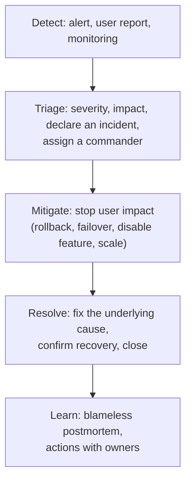

# Incident response and postmortems

> **Status: AI draft, 2026-11-16.** Not yet verified by me. Written from the Google SRE book and workbook and the Atlassian incident management handbook; general practice, no commands.

## In one line

An incident runs detect, triage, mitigate, resolve, learn: one commander coordinates while others operate and communicate, user impact is stopped before the root cause is found, a timeline is kept, and a blameless postmortem ends in owned actions.

## The plain idea

When production is broken, the natural instinct is for everyone to start debugging at once. That produces duplicated work, conflicting changes, nobody talking to users, and a slower recovery. Incident response is a lightweight structure that keeps a group of people working as one: clear roles, an agreed order of priorities (stop the bleeding first), and a written record. The postmortem afterwards turns one bad day into fewer bad days.

## How it works

### The phases

### Roles

| Role | Does | Does not |
|---|---|---|
| **Incident commander** | Holds the overall picture, decides priorities, assigns work, calls for help, decides when it is over | Debug hands-on (except in small incidents where one person holds several roles) |
| **Operations lead** and responders | Investigate and change systems, only as agreed with the commander | Make uncoordinated changes |
| **Communications lead** | Updates stakeholders and status pages on a schedule | Promise times nobody has agreed |
| **Scribe** (often the commander in small incidents) | Keeps the timeline: what was seen, decided and changed, with times | |

The Google SRE book describes the same separation: a commander holding state, operational work, communication and planning as distinct roles, with the commander holding any role not delegated.

### Mitigate first

The aim during the incident is to stop user impact, not to understand it:

- Roll back the last deploy or config change ([Promotion, rollback and troubleshooting](../gitops/promotion-and-rollback.md), [Deployment strategies](../cicd/deployment-strategies.md)).
- Fail over to another zone, region or replica ([High availability and failure domains](high-availability.md)).
- Disable a feature flag; shed load; scale out; block an abusive client.
- Root-cause analysis happens later, from the timeline, logs and metrics that were kept.

"What changed recently?" is usually the fastest question: deploys, config, infrastructure, traffic, dependencies.

### Severity levels (example)

| Severity | Meaning | Response |
|---|---|---|
| SEV1 | Major user impact: core journey down, data loss, security breach | Page immediately, commander assigned, frequent updates, postmortem required |
| SEV2 | Significant degradation or a subset of users affected | Page, commander assigned, postmortem expected |
| SEV3 | Minor impact, workaround exists | Business hours, ticket |

Define levels in advance by user impact, not by which component broke ([SLOs and error budgets](../observability/slos.md)).

### Timeline and communication

- One channel per incident; decisions and actions written there with times.
- Status updates on a fixed cadence (for example every 30 minutes for SEV1), even when there is no news: what is affected, what is being done, next update time.
- Hand over explicitly when people rotate out.

### The blameless postmortem

| Section | Content |
|---|---|
| Summary | What happened, in two or three sentences |
| Impact | Who was affected, how, for how long; SLO budget consumed |
| Timeline | Detection, key decisions, mitigation, resolution, with times |
| Contributing factors | Technical and process conditions that allowed it (usually several, not one "root cause") |
| What went well | Things to keep: fast detection, a runbook that worked |
| What was hard | Missing dashboards, confusing alerts, slow access |
| Actions | Specific changes with an owner and a date; prioritised |

**Blameless** means asking "how did our system and process make this mistake easy?" rather than "who did it?". People hide information when they expect blame, and the real fixes are in tooling and process anyway.

### What interviewers listen for

- You mitigated before root-causing, and you knew how to roll back.
- You communicated: who you told, how often.
- You used data (metrics, logs, recent changes), not guesses.
- Your postmortem led to concrete changes (an alert, a test, a guardrail), and you can say what changed afterwards.
- You talk about "we" and the system, not blame ([How to answer](../interview/how-to-answer.md)).

## A concrete example

A SEV2, told as a timeline:

1. 10:02: SLO burn-rate alert for checkout errors ([Alerting and Alertmanager](../observability/alerting.md)).
2. 10:05: on-call declares an incident, takes command, asks a teammate to investigate and another to post updates.
3. 10:09: dashboards show errors began at 09:58; the deploy log shows a release at 09:56.
4. 10:12: the commander decides to roll back; the revert is merged, and auto-sync applies it by 10:16.
5. 10:20: error rate back to normal; incident downgraded to monitoring; update posted.
6. Postmortem: a config key was renamed without a default. Actions: a startup check for required config (owner, date), canary analysis for checkout (owner, date), a test in the pipeline (owner, date).

## Why not just...?

- **...let the most senior person debug and also coordinate?** Deep debugging and coordination compete for attention; one of them suffers. Separate the roles as soon as more than one or two people are involved.
- **...find the root cause before acting, to fix it properly?** Users suffer the whole time. Mitigate first, investigate with the evidence you kept.
- **...skip the postmortem for small incidents?** Small incidents are cheap lessons for the same causes as large ones. Keep postmortems short, but do them.

## How it breaks

| Symptom | Layer | Check | Likely cause |
|---|---|---|---|
| Two people made conflicting changes during the incident | Coordination | Who decided what | No incident commander; no single channel |
| Stakeholders kept asking for news | Communication | Update cadence | No communications role or schedule |
| Long outage while the team debugged | Priorities | When mitigation started | Root-causing before mitigating; no known rollback |
| Same incident happened again | Learning | Postmortem actions | Actions without owners or dates, never done |
| People hid what they did | Culture | Postmortem tone | Blame for individuals instead of the system |

## Interview questions

**1. Walk me through how you handle a production incident.**

Answer

- Detect and assess impact; declare an incident with a severity and a commander.
- Mitigate first (rollback, failover, flag), coordinating changes; communicate on a cadence.
- Resolve, confirm recovery, then a blameless postmortem with owned actions.

**2. What does an incident commander do?**

Answer

- Holds the overall state, sets priorities, assigns roles and work, and decides when it is over.
- Keeps people from making uncoordinated changes; calls for more help.
- Usually does not debug hands-on in larger incidents.

**3. Why mitigate before finding the root cause?**

Answer

- Every minute of investigation is a minute of user impact.
- Rollback, failover or disabling a feature often restores service without knowing why.
- The timeline and data kept during the incident support the analysis afterwards.

**4. What makes a postmortem blameless, and why does it matter?**

Answer

- It focuses on system and process conditions that made the error possible, not on individuals.
- People share what really happened when they are not afraid of blame.
- The resulting fixes (guardrails, tests, alerts) prevent the class of problem, not one person's mistake.

**5. What goes into a postmortem?**

Answer

- Summary, impact, timeline, contributing factors, what went well and badly.
- Actions with owners and dates, prioritised.
- Shared widely so other teams learn.

**6. Tell me about an incident you handled. (How to structure the answer)**

Answer

- Situation and impact in one or two sentences; your role.
- What you did, in order: detection, mitigation, communication, resolution, with the reasoning.
- The result, the postmortem actions, and what changed afterwards ([STAR stories](../interview/star-stories.md)).

## Try it

1. Write the severity table for a service you know, defined by user impact.
2. Take an incident you remember and write its timeline and three postmortem actions with owners.
3. Practise a two-minute spoken answer to "tell me about an incident" using the structure in question 6.

## Zoom out

Incident response connects observability (detection), deployment practice (rollback), high availability (failover) and change management (prevention) into one loop ([Alerting and Alertmanager](../observability/alerting.md), [Change management](change-management.md)).

## Sources

- [Google SRE book: managing incidents](https://sre.google/sre-book/managing-incidents/)
- [Google SRE book: postmortem culture](https://sre.google/sre-book/postmortem-culture/)
- [Google SRE workbook: incident response](https://sre.google/workbook/incident-response/)
- [Atlassian: incident management handbook](https://www.atlassian.com/incident-management/handbook)
