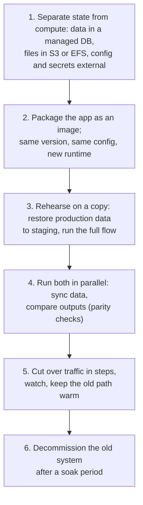

# Migration patterns

> **Status: AI draft, 2026-11-16.** Not yet verified by me. Written from AWS Prescriptive Guidance, the AWS DMS documentation and Martin Fowler's strangler fig pattern; general practice, no commands run.

## In one line

Pick how much to change (rehost, replatform or refactor), separate state from compute, rehearse on a copy, keep old and new in sync while you compare them, cut over in the smallest steps the system allows (gradual beats big bang), keep a tested way back until the old system is decommissioned.

## The plain idea

A migration replaces something that works with something that should work better, while users keep using it. The danger is not the new system; it is the moment of switching, and the data that has to arrive intact on the other side. Good migrations make that moment small, rehearsed and reversible: run old and new side by side, prove they behave the same, move traffic a little at a time, and only remove the old system when nobody could need it back.

## How it works

### How much to change

AWS's prescriptive guidance lists seven strategies (the "7 Rs"): retire, retain, rehost, relocate, repurchase, replatform, and refactor or re-architect. The three that matter most for engineers:

| Strategy | What changes | Example | Trade-off |
|---|---|---|---|
| **Rehost** ("lift and shift") | Nothing in the app; new infrastructure | VM image moved to EC2 | Fast, low risk, few cloud benefits |
| **Replatform** | Some components swapped for managed or containerised ones | App moved to containers on EKS; self-run database to RDS | Moderate effort, real operational gains |
| **Refactor** | The application's architecture | Monolith split into services, or moved to serverless | Most benefit, most effort and risk; AWS's guidance does not recommend it for large migrations |

Do one kind of change at a time where you can: moving and redesigning simultaneously doubles the unknowns.

### Moving a stateful service from VMs to containers

- **Separate state first.** Containers are replaceable; anything written to the local disk is lost on restart. Move data to a database, files to object or shared storage, configuration and secrets to external stores ([ConfigMaps and Secrets](../kubernetes/configmaps-and-secrets.md), [Secrets management](../security/secrets-management.md)).
- **Rehearse on a copy** of real data and traffic patterns. The first run always finds something: a hard-coded path, a missing file permission, a cron job nobody documented.
- **Parity checks**: compare the old and new systems' outputs on the same inputs (record counts, checksums, API responses, business metrics). "It started" is not "it works the same".

### Cutover styles

| Style | How | Risk | Rollback |
|---|---|---|---|
| **Big bang** | Everything switches at one moment | Highest; all problems appear at once | Hard once new data is written |
| **Blue-green** | New system complete beside the old; switch traffic in one step | Medium | Switch back, if data is still in sync ([Deployment strategies](../cicd/deployment-strategies.md)) |
| **Gradual (strangler fig)** | Route one function, endpoint or customer group at a time to the new system; the old one shrinks | Lowest per step | Route that slice back |

The **strangler fig** pattern (named by Martin Fowler) puts a routing layer (a load balancer, API gateway or mesh) in front of the old system and moves capabilities behind it one by one until the old system can be removed ([Load balancers and proxies](../networking/load-balancers-and-proxies.md)).

### Data migration and sync

- **Full load, then change data capture**: copy everything once, then replicate ongoing changes until cutover. AWS DMS calls this ongoing replication or change data capture (CDC); databases also have native replication.
- At cutover: stop writes on the old side (or switch writers), let replication catch up, verify counts, switch.
- **Reverse replication** (new back to old) after cutover keeps a real rollback option open for a while.
- Schema changes follow expand and contract, so both versions can run against the data during the transition ([Deployment strategies](../cicd/deployment-strategies.md)).

### The rollback plan, and a rollback drill

Write the rollback before the cutover, and practise it: switch traffic back in staging, under time pressure, and measure how long it takes. A rollback plan that has never run is a hope ([Change management](change-management.md)).

### Decommissioning

The migration is not finished until the old system is gone:

1. Soak period with the old system idle but restorable.
2. Final backup or snapshot, kept per the retention policy ([Backup and disaster recovery](backup-and-dr.md)).
3. Remove DNS records, load balancer rules, credentials, IAM roles, firewall rules, monitoring and alerts that pointed at it.
4. Delete the resources, and confirm the cost actually drops ([Cost optimisation](cost-optimisation.md)).

## A concrete example

`sample-app`'s order service moves from two VMs to EKS:

1. Uploads move from the VM disk to S3; the database is already RDS; configuration becomes a ConfigMap, secrets come from Secrets Manager.
2. The same version is containerised; staging runs it against a restored copy of production data; two undocumented cron jobs are found and turned into CronJobs ([Jobs and CronJobs](../kubernetes/jobs-and-cronjobs.md)).
3. In production the ALB sends 5% of requests to the EKS target group, then 25%, 50%, 100% over a week, with error rate and latency compared per target group ([ALB and NLB](../aws-core/load-balancers.md)).
4. Rollback is one listener change, drilled in staging (2 minutes).
5. After two weeks at 100% with the VMs stopped, a final snapshot is taken and the VMs, their security groups and their alarms are deleted.

## Why not just...?

- **...move and redesign in one step?** When it breaks, you cannot tell whether the platform or the redesign is at fault. Move first, improve after.
- **...do a big-bang weekend cutover to get it over with?** Every problem surfaces at once with no partial fallback, and data written after the switch makes rollback hard. Use gradual cutover where the system allows.
- **...keep the old system "just in case" indefinitely?** It keeps costing money, keeps credentials alive and drifts out of date until it cannot be a fallback anyway. Set a decommission date.

## How it breaks

| Symptom | Layer | Check | Likely cause |
|---|---|---|---|
| Data missing after cutover | Sync | Replication lag, row counts | Cut over before replication caught up; writes still going to the old side |
| New system works in tests, fails in production | Rehearsal | Differences from staging | Rehearsed without real data volume or real traffic patterns |
| Rollback impossible | Data | Writes since cutover | No reverse replication; schema changed irreversibly |
| Jobs stopped running after the move | Hidden dependencies | Old host's cron, scripts | Undocumented jobs on the old servers |
| Old system still billed months later | Decommissioning | Cost by resource | No decommission plan or date |

## Interview questions

**1. What are rehost, replatform and refactor?**

Answer

- Rehost: move as is to new infrastructure.
- Replatform: swap some components for managed or containerised ones without redesigning the app.
- Refactor: change the architecture; most benefit, most effort and risk.

**2. How would you move a stateful service from VMs to Kubernetes?**

Answer

- Separate state first (database, object storage, external config and secrets), then containerise the same version.
- Rehearse on a copy of production data; run old and new in parallel with parity checks.
- Shift traffic gradually with a drilled rollback, then decommission.

**3. What is the strangler fig pattern?**

Answer

- A routing layer in front of the old system sends one capability at a time to the new system.
- The old system shrinks until it can be removed.
- Each step is small and reversible.

**4. How do you migrate a database with minimal downtime?**

Answer

- Full load, then ongoing replication (change data capture) until cutover.
- At cutover: stop writes, let replication catch up, verify, switch the application.
- Keep reverse replication for a while as a rollback path.

**5. What does a good rollback plan for a migration contain?**

Answer

- The trigger (what result means roll back), the exact steps, who decides, and the time it takes.
- How data written after cutover gets back to the old side.
- Evidence it works: a drill in staging.

**6. When is a migration finished?**

Answer

- When the old system is decommissioned: soak period over, final backup kept, DNS, credentials, rules, alerts and resources removed.
- And the cost and access reductions are confirmed.
- Until then, the old system is a risk and a cost.

## Try it

1. Pick a service you know and write which of the 7 Rs fits it, and why not the others.
2. Write the cutover plan for moving it with a gradual traffic shift: steps, checks, rollback trigger.
3. List everything you would remove when decommissioning its old environment.

## Zoom out

Migrations combine most operations skills: change management, deployment strategies, data protection and decommissioning ([Change management](change-management.md), [Deployment strategies](../cicd/deployment-strategies.md), [Backup and disaster recovery](backup-and-dr.md)). In interviews, a migration story with parity checks and a drilled rollback shows judgement more than any tool list ([STAR stories](../interview/star-stories.md)).

## Sources

- [AWS Prescriptive Guidance: migration strategies (the 7 Rs)](https://docs.aws.amazon.com/prescriptive-guidance/latest/large-migration-guide/migration-strategies.html)
- [AWS DMS User Guide: what is AWS Database Migration Service](https://docs.aws.amazon.com/dms/latest/userguide/Welcome.html)
- [AWS DMS User Guide: ongoing replication (CDC)](https://docs.aws.amazon.com/dms/latest/userguide/CHAP_Task.CDC.html)
- [Martin Fowler: StranglerFigApplication](https://martinfowler.com/bliki/StranglerFigApplication.html)
