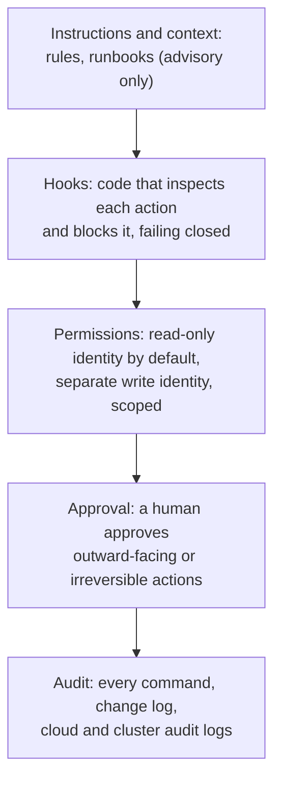

# Guardrails for AI agents in operations

> **Status: AI draft, 2026-11-16.** Not yet verified by me. General principles, with sources for the specific claims (OWASP's "excessive agency" risk, NIST's AI Risk Management Framework, and one agent tool's hook documentation as an example of deterministic controls).

## In one line

An AI agent with shell or cloud access is a fast, confident operator that is sometimes wrong. Give it read-only access by default, block dangerous actions with hooks that fail closed, make it show the blast radius and a rollback before acting, keep human approval for what matters, and audit everything.

## The plain idea

An AI coding or operations agent turns text into commands. That is useful precisely because it acts, and dangerous for the same reason: a misunderstood instruction, a wrong assumption about which cluster is selected, or a malicious instruction hidden in a file it reads can become `kubectl delete` or `terraform destroy` within seconds. OWASP calls the underlying risk **excessive agency**, with three root causes: excessive functionality, excessive permissions and excessive autonomy.

The controls are the same ones we apply to people and pipelines (least privilege, change control, audit), plus one new rule: instructions in a prompt are advice the model may not follow; only controls outside the model are guarantees.

## How it works

### Layers of control

| Layer | Strength | Example |
|---|---|---|
| Instructions | Advisory: the model usually follows them, not always | "Never delete with a label selector" in the agent's guidance file |
| Hooks | Deterministic: code that runs before every tool call and can refuse it | A pre-command hook that rejects `kubectl delete` with `-l` or `--all`; agent tools such as Claude Code document hooks that run before a tool call and can block it, including when the hook itself fails |
| Permissions | Enforced by the target system | The agent's AWS role and Kubernetes RBAC allow only `get`, `list`, `describe` |
| Human approval | Strong but tiring | Explicit approval for pushes, deploys, deletions, anything visible to others |
| Audit | Detective | Shell history, agent transcripts, CloudTrail, Kubernetes audit logs |

### Read-only by default, separate identities for writing

- Give the agent its own identity, never a human's admin session: a read-only AWS role, a Kubernetes user bound to `view`, a Git token without push rights ([RBAC and service accounts](../kubernetes/rbac-and-service-accounts.md), [Least privilege and AccessDenied](../aws-core/least-privilege-and-accessdenied.md)).
- Write access through a different, narrow identity that must be chosen deliberately, ideally through the same pipeline as human changes ([OIDC from pipelines to AWS](../cicd/oidc-to-aws.md)).
- Prefer changes that land as pull requests in Git (GitOps, Terraform) over direct mutations: the review, plan and history come for free ([GitOps principles](../gitops/principles.md)).

### Hooks that fail closed

A good guardrail hook:

- runs on every command, not only when the model decides to "check";
- matches patterns that are hard to undo: bulk deletes (`-l`, `--all`, wildcards), `terraform destroy` or `apply -auto-approve`, `git push --force`, IAM changes, deleting state or backups;
- **fails closed**: if the hook crashes or a required tool is missing, the action is blocked, not allowed;
- explains why it blocked, so the agent (and the human) can choose a safer path.

The same pattern protects this site: its git hooks block commits and pushes that contain anything that looks like a real identifier or secret, and block the push entirely if the scanner cannot run ([Quality and security gates](../cicd/quality-and-security-gates.md)).

### Blast radius before action

Before any change, the agent should show exactly what it will touch:

- the list of objects a selector matches (`kubectl get -l app=old -A`), not just the delete command ([Labels, selectors and namespaces](../kubernetes/labels-selectors-namespaces.md));
- the Terraform plan, read for deletes and replacements ([Reading a plan](../iac/reading-a-plan.md));
- dry runs (`--dry-run=server`, `kubectl diff`) where the tool supports them;
- which account, region, cluster and namespace the session is pointed at.

### Change log and rollback first

Ask for, and check, a written plan before the first mutating command: what will change, in what order, how to verify each step, and how to undo it. If the agent cannot state the rollback, it is not ready to make the change. This is ordinary change management, applied to a fast actor ([Change management](../operations/change-management.md)).

### Human approval and its limits

Approval prompts work only while people read them. Many prompts lead to reflexive "yes". Keep approvals for actions that matter (outward-facing, irreversible, production), make everything else safe by permission design, and never let approval be the only control.

### Inputs are untrusted

Files, web pages, tickets and logs the agent reads can contain instructions written by someone else (prompt injection). Treat them as data: the agent's permissions and hooks must hold even if it is tricked into trying something.

### What to audit

- Every command the agent ran, with the working directory and identity used.
- Cloud and cluster audit logs filtered by the agent's identity.
- Diffs of every file changed; commits attributed to the agent.
- Blocked actions: a pattern of blocks is a signal to fix instructions or permissions.

## A concrete example

An agent is asked to "clean up the old demo resources" in a shared cluster:

1. Its identity can only read; the request needs deletes, so it must produce a plan instead.
2. The plan lists objects by name, from `kubectl get` output, with the namespace and cluster context shown; a selector-based delete is refused by a hook.
3. A human reviews the list, notices two objects belonging to another team, and removes them from it.
4. The deletes run under a separate, time-limited identity scoped to that namespace, by name, with `--dry-run=server` first.
5. The transcript, the plan and the audit log entries are kept with the change record.

## Why not just...?

- **...write "be careful, never delete production" in the agent's instructions?** Instructions are advisory; the model can misread context or be manipulated. Enforce with permissions and hooks.
- **...give the agent the same admin access as the engineer using it?** Every mistake then has admin blast radius. The agent should have less access than its user, not the same.
- **...approve every single command?** Approval fatigue makes the prompts meaningless. Make most actions safe by design, and keep approvals for the few that matter.

## Commands to know

| Command | Use as a guardrail |
|---|---|
| `kubectl auth can-i --list --as=<agent-identity>` | Check what the agent's identity can really do |
| `kubectl get <kind> -l <selector> -A` | Show what a selector matches before any delete |
| `kubectl delete ... --dry-run=server` | Ask the API server what would happen |
| `terraform plan -out=tfplan` then review | Read deletes and replacements before applying |
| `aws sts get-caller-identity` | Confirm which account and role a session uses |
| `kubectl config current-context` | Confirm which cluster commands will hit |

## How it breaks

| Symptom | Layer | Check | Likely cause |
|---|---|---|---|
| Agent deleted more than intended | Blast radius | What the selector matched | Bulk delete without listing matches; no hook |
| Agent acted on the wrong cluster or account | Context | Current context and identity | No context check before acting |
| A guardrail silently stopped working | Hook | Hook failure mode | Hook failed open when a tool was missing |
| Agent followed instructions from a file it read | Input handling | Source of the instruction | Prompt injection with permissions to act on it |
| Approvals given without reading | Human process | Approval volume | Too many prompts for low-risk actions |

## Interview questions

**1. Why is an AI agent with shell access a new kind of risk?**

Answer

- It turns text into actions quickly and confidently, including wrong ones.
- It can be misled by its inputs (prompt injection).
- OWASP's "excessive agency" names the root causes: too much functionality, permission and autonomy.

**2. What is the difference between an instruction and a hook as a control?**

Answer

- An instruction is advice the model usually follows.
- A hook is code that runs before every action and can block it deterministically.
- Hooks should fail closed: if they break, actions are blocked.

**3. How would you set up identities for an operations agent?**

Answer

- Its own read-only identity by default (cloud role, Kubernetes `view`, Git without push).
- A separate, narrow write identity used deliberately, ideally through pipelines and pull requests.
- Never a human's admin session.

**4. What should happen before an agent makes a change?**

Answer

- A written plan with order, verification and rollback.
- The exact blast radius: matched objects listed, a plan or dry run read.
- The target context (account, cluster, namespace) confirmed, then approval where it matters.

**5. What are the limits of human approval?**

Answer

- People approve reflexively when asked too often.
- Approval cannot catch what the prompt does not show.
- Use it for a few high-impact actions on top of permissions and hooks, not instead of them.

**6. What would you audit for agent activity?**

Answer

- Commands run, identity and target used, files and commits changed.
- Cloud and cluster audit logs for the agent's identity.
- Blocked actions, as signals to improve guardrails.

## Try it

1. List the five commands in your daily work that would be most damaging if run by mistake, and write a pattern a hook could use to block each.
2. Write the `kubectl` RBAC Role you would give a read-only troubleshooting agent in one namespace.
3. For a change you made recently, write the change log and rollback an agent should have produced before starting.

## Zoom out

Guardrails for agents are least privilege, change management and audit, applied to a faster, less predictable operator ([Pipeline security](../cicd/pipeline-security.md), [Change management](../operations/change-management.md)). The habits are the same ones that keep human operators safe.

## Sources

- [OWASP GenAI Security Project: LLM06 Excessive Agency](https://genai.owasp.org/llmrisk/llm062025-excessive-agency/)
- [OWASP Top 10 for LLM Applications](https://genai.owasp.org/llm-top-10/)
- [NIST: AI Risk Management Framework](https://www.nist.gov/itl/ai-risk-management-framework)
- [Claude Code documentation: hooks (an example of deterministic pre-action checks)](https://code.claude.com/docs/en/hooks)
