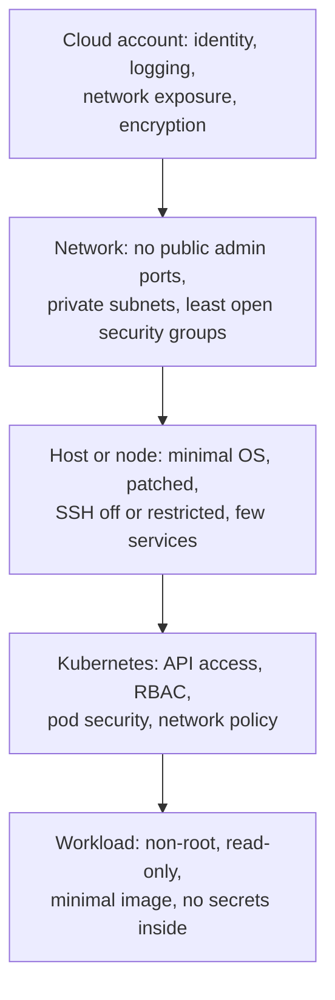

# Hardening and benchmarks

> **Status: AI draft, 2026-11-16.** Not yet verified by me. Written from the AWS, Kubernetes and kube-bench documentation; nothing was run.

## In one line

Hardening means removing what an attacker could use: unneeded services, ports, users, privileges and defaults. CIS Benchmarks turn that into checkable rules for operating systems, Kubernetes and AWS accounts, and scanners (kube-bench, Security Hub) check them continuously; treat the results as evidence to act on, not a score to chase.

## The plain idea

Every running service, open port, admin user, default password and broad permission is something that can be attacked. Most breaches use simple things left open: a management port on the internet, an old key, a public bucket, a container running as root with host access. **Hardening** is the habit of turning off what you do not need and narrowing what you do.

**Benchmarks** are community checklists of those settings (the CIS Benchmarks are the best known), precise enough for tools to check automatically. They give teams a common baseline and auditors evidence.

## How it works

### Layers

### Host basics

| Area | Hardening |
|---|---|
| Remote access | Prefer no SSH at all (Systems Manager Session Manager); if needed, keys only, no root login, no passwords ([SSH](../linux/ssh.md), [Systems Manager](../aws-services/systems-manager.md)) |
| Users | No shared accounts; least privilege; sudo audited ([Users, groups and permissions](../linux/permissions.md)) |
| Services | Disable and remove what is not needed; check listening ports with `ss -tlnp` ([Network tools on Linux](../networking/network-tools.md)) |
| Firewall | Default deny inbound; security groups as the main control in AWS ([Firewalls and connection tracking](../networking/firewalls.md)) |
| Updates | Automatic security updates or regular image rebuilds ([Vulnerability and patch management](vulnerability-and-patch-management.md)) |
| Images | Minimal, purpose-built AMIs and container images, rebuilt often |

### Cloud posture basics (AWS)

- No administrative ports (SSH, RDP, database ports) open to `0.0.0.0/0` ([Security groups and NACLs](../aws-core/security-groups-and-nacls.md)).
- MFA for every human; no root account use; SSO instead of IAM users ([Federation and SSO](../aws-core/federation-and-sso.md)).
- No long-lived access keys; roles and OIDC everywhere ([OIDC from pipelines to AWS](../cicd/oidc-to-aws.md)).
- Encryption at rest by default (EBS, S3, RDS), and in transit.
- Logging on: CloudTrail in every region, Config, VPC Flow Logs where needed ([CloudTrail, Athena and Config](../aws-services/cloudtrail-and-config.md)).
- Guardrails at the organisation level: SCPs that prevent disabling logging or leaving approved regions ([Organizations, SCPs and multi-account](../aws-core/organizations-and-scps.md)).

The CIS AWS Foundations Benchmark and AWS's Foundational Security Best Practices are available as standards in Security Hub, which evaluates accounts against them continuously ([GuardDuty, Security Hub and Inspector](../aws-services/security-services.md)).

### Kubernetes pointers

- API server endpoint private or restricted ([EKS architecture and node options](../eks/architecture.md)).
- RBAC least privilege; no broad `cluster-admin` bindings ([RBAC and service accounts](../kubernetes/rbac-and-service-accounts.md)).
- Pod Security Admission at `restricted` where possible ([Pod security](../kubernetes/pod-security.md)).
- NetworkPolicy default deny per namespace ([Pod networking and NetworkPolicy](../kubernetes/pod-networking-and-network-policy.md)).
- Secrets encrypted and access-controlled ([Secrets management](secrets-management.md)).
- Nodes: minimal AMIs, IMDSv2 with hop limit 1, regular replacement ([Cluster access, IRSA and Pod Identity](../eks/access-and-pod-identity.md)).
- kube-bench runs the checks in the CIS Kubernetes Benchmark (including an EKS variant) against nodes and control plane components it can reach.

### Evidence over checklists

A benchmark report is useful when it changes something:

- Fix the findings that reduce real exposure first (public access, admin permissions, missing logging), not the easiest ones.
- Record accepted exceptions with reasons and owners.
- Prefer controls that make the bad state impossible (SCPs, admission policies, Terraform modules with safe defaults) over reports that detect it afterwards ([CRDs, operators and admission webhooks](../kubernetes/crds-and-operators.md)).
- Re-check continuously; a passing report from last quarter proves little today.

## A concrete example

Hardening a new AWS account and EKS cluster, in priority order:

1. Organisation SCPs: deny leaving approved regions, deny disabling CloudTrail and GuardDuty.
2. SSO for people, OIDC for pipelines, no IAM users with keys.
3. Security Hub with the CIS and Foundational standards; findings routed to the platform team.
4. VPC: private subnets for nodes and databases; no security group allows admin ports from the internet.
5. EKS: private endpoint plus restricted public CIDRs, access entries, Pod Security `restricted` for app namespaces, default-deny NetworkPolicies, IMDSv2 hop limit 1.
6. Monthly review of open findings and exceptions.

## Why not just...?

- **...aim for 100% benchmark compliance?** Some checks do not fit your environment, and chasing the score diverts effort from the findings that matter. Fix by risk, document exceptions.
- **...harden once at launch?** Configuration drifts, new services appear, defaults change. Make hardening part of templates and checks that run continuously.
- **...rely on the network perimeter?** One compromised pod or credential is already inside. Defence in depth: identity, workload and data controls as well.

## Commands to know

| Command | What it does |
|---|---|
| `ss -tlnp` | Listening TCP ports and their processes on a host. |
| `systemctl list-unit-files --state=enabled` | Services that start at boot ([systemd and services](../linux/systemd.md)). |
| `kubectl get clusterrolebindings -o wide` | Who is bound to which ClusterRole; look for `cluster-admin`. |
| `kubectl get ns --show-labels` | Pod Security levels per namespace. |
| `aws securityhub get-findings --filters ...` | Benchmark findings in Security Hub. |
| `aws ec2 describe-security-groups --filters Name=ip-permission.cidr,Values=0.0.0.0/0` | Security groups open to the internet. |

## How it breaks

| Symptom | Layer | Check | Likely cause |
|---|---|---|---|
| Admin port reachable from the internet | Network | Security groups | A rule added during troubleshooting and never removed |
| Benchmark score good, breach anyway | Coverage | What the benchmark checks | Benchmarks do not cover application flaws or leaked credentials |
| Hardening broke an application | Change process | What changed | Applied without testing; no staged rollout |
| Findings never decrease | Process | Ownership | No owner or priority for findings |
| Same misconfiguration in every new account | Templates | Baseline modules | Hardening not built into account and cluster templates |

## Interview questions

**1. What does hardening mean, and how do you start?**

Answer

- Reducing attack surface: fewer services, ports, users, privileges and defaults.
- Start with the highest exposure: internet-facing admin access, long-lived credentials, public data, missing logging.
- Build the result into templates so new systems start hardened.

**2. What are CIS Benchmarks and how are they used?**

Answer

- Consensus configuration guidelines for operating systems, Kubernetes, cloud accounts and more.
- Tools check them automatically: Security Hub for AWS, kube-bench for Kubernetes.
- Use them as a baseline and evidence; prioritise by risk and record exceptions.

**3. List cloud posture basics you would check in a new AWS account.**

Answer

- MFA, SSO, no root use, no long-lived access keys.
- No admin ports open to the internet; private subnets for data.
- Encryption by default; CloudTrail, Config and GuardDuty on; SCP guardrails.

**4. How would you harden an EKS cluster?**

Answer

- Restricted API endpoint, access entries, least-privilege RBAC.
- Pod Security restricted, default-deny NetworkPolicies, secrets encrypted with tight access.
- Minimal node AMIs replaced regularly, IMDSv2 hop limit 1, workload identity instead of node roles.

**5. Why prefer preventive controls over detective ones?**

Answer

- Prevention (SCPs, admission policies, safe module defaults) stops the bad state from existing.
- Detection finds it after the fact, when exposure may already have happened.
- Use both: prevent what you can, detect the rest.

**6. A scanner reports 400 benchmark failures across your accounts. How do you approach it?**

Answer

- Group by control and rank by real exposure: public access, admin permissions, missing logging first.
- Fix at the source (templates, modules, SCPs) so the same failure stops reappearing.
- Document accepted exceptions with owners and review dates; track the trend, not just the count.

## Try it

1. In an `ubuntu:24.04` container, install `openssh-server` and run `ss -tlnp` before and after starting it; note what appears ([SSH](../linux/ssh.md)).
2. Write five SCP or admission-policy rules that would prevent the five most dangerous misconfigurations you can think of.
3. Pick one CIS AWS Foundations control from the Security Hub documentation and describe how you would fix it with Terraform.

## Zoom out

Hardening is the layered, continuous version of least privilege, applied to hosts, accounts, clusters and workloads ([Least privilege and AccessDenied](../aws-core/least-privilege-and-accessdenied.md), [Pod security](../kubernetes/pod-security.md)). Benchmarks make it measurable; templates and policies make it stick.

## Sources

- [AWS Security Hub: CIS AWS Foundations Benchmark](https://docs.aws.amazon.com/securityhub/latest/userguide/cis-aws-foundations-benchmark.html)
- [AWS Security Hub: Foundational Security Best Practices](https://docs.aws.amazon.com/securityhub/latest/userguide/fsbp-standard.html)
- [AWS Well-Architected: security pillar](https://docs.aws.amazon.com/wellarchitected/latest/security-pillar/welcome.html)
- [Amazon EKS Best Practices Guide: security](https://docs.aws.amazon.com/eks/latest/best-practices/security.html)
- [Kubernetes documentation: security checklist](https://kubernetes.io/docs/concepts/security/security-checklist/)
- [kube-bench (CIS Kubernetes Benchmark checks)](https://github.com/aquasecurity/kube-bench)
