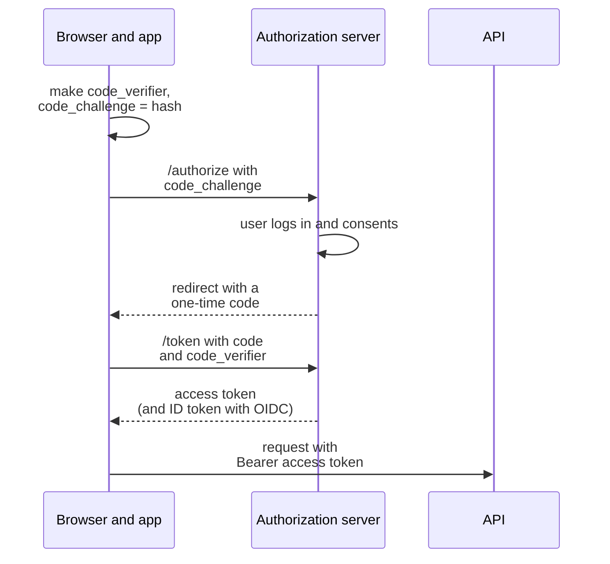

# OAuth 2.0, OIDC and JWTs

> **Status: AI draft, 2026-11-16.** Not yet verified by me. Written from the OAuth, OIDC and JWT specifications; the decoded token below is real, from a kind cluster (Kubernetes 1.37), with its key ID, token ID, UID and times replaced by placeholders. Only decoded JSON is shown, never an encoded token.

## In one line

OAuth 2.0 gives a client a scoped access token to call an API (authorisation); OpenID Connect adds an ID token saying who the user is (authentication). Apps use the code flow with PKCE, machines client credentials, and JWTs must be checked for signature, issuer, audience and expiry.

## The plain idea

Two different questions:

- **Authentication**: who are you? ("This is user alice.")
- **Authorisation**: what may you do? ("This app may read alice's calendar.")

OAuth 2.0 answers the second: instead of giving an app your password, you approve it at the identity provider, which hands the app a **token** limited in scope and time. OpenID Connect (OIDC) is a thin layer on top that also answers the first, with an **ID token** describing the user. Many tokens are **JWTs**: a JSON payload plus a signature, so any service with the issuer's public key can verify it without calling the issuer.

## How it works

### OAuth roles

| Role | Example |
|---|---|
| **Resource owner** | The user |
| **Client** | The app that wants access (a web app, a CLI, a CI job) |
| **Authorization server** | The identity provider that issues tokens (Cognito, Okta, Entra ID, Keycloak, a CI system's OIDC issuer) |
| **Resource server** | The API that accepts tokens |

### Authorization code flow with PKCE



- The code travels through the browser, where it could be intercepted; PKCE ties it to a secret (`code_verifier`) that only the app knows, so a stolen code is useless.
- The OAuth security best current practice (RFC 9700) requires PKCE for public clients (single-page apps, mobile, CLIs) and recommends it for all clients, and says clients should not use the old implicit grant, which returned tokens directly in the browser redirect.

### Client credentials flow (machines)

A service authenticates as itself with a client ID and secret (or a private key) and receives an access token: no user involved. Where possible, replace stored secrets with workload identity: the platform issues the workload a signed token, which it exchanges for credentials, as in CI to AWS and IRSA ([OIDC from pipelines to AWS](../cicd/oidc-to-aws.md), [Cluster access, IRSA and Pod Identity](../eks/access-and-pod-identity.md)).

### OIDC adds identity

With scope `openid`, the token response also contains an **ID token**: a JWT with the user's identity (`sub`, `email`, `name`) for the *client* to read. Access tokens are for *APIs*. Sending an ID token to an API as if it were an access token is a common mistake.

### JWT anatomy

A JWT is three base64url parts joined by dots: header, payload, signature. A real one from a kind cluster (`kubectl create token default --audience=https://api.example.com`), decoded:

```json
{
  "alg": "RS256",
  "kid": "<key-id>"
}
```

```json
{
  "aud": ["https://api.example.com"],
  "exp": "<unix-time>",
  "iat": "<unix-time>",
  "iss": "https://kubernetes.default.svc.cluster.local",
  "jti": "<token-id>",
  "kubernetes.io": {
    "namespace": "default",
    "serviceaccount": { "name": "default", "uid": "<uid>" }
  },
  "nbf": "<unix-time>",
  "sub": "system:serviceaccount:default:default"
}
```

The third part is a 256-byte RSA signature over the first two.

| Claim | Meaning |
|---|---|
| `iss` | Issuer: who made the token |
| `sub` | Subject: who it is about |
| `aud` | Audience: who it is meant for |
| `exp`, `nbf`, `iat` | Expires at, not valid before, issued at |
| `jti` | Unique token ID |
| Others | Issuer-specific claims, such as `kubernetes.io` above or `scope`, `groups` |

### Validating a JWT

1. Parse the header; only accept algorithms you expect (never `none`).
2. Fetch the issuer's public keys from its **JWKS** endpoint (found through the OIDC discovery document `/.well-known/openid-configuration`), pick the key by `kid`, verify the signature.
3. Check `iss` is the issuer you trust and `aud` contains *your* API.
4. Check `exp` and `nbf` with a small clock-skew allowance.
5. Only then use the claims (subject, scopes, groups) for authorisation.

The payload is only encoded, not encrypted: anyone holding the token can read it, so never put secrets in claims.

## A concrete example

Where these show up in a DevOps job:

| Situation | Flow and token |
|---|---|
| Engineers log in to AWS, Argo CD, Grafana | OIDC or SAML single sign-on from the company identity provider ([Federation and SSO](../aws-core/federation-and-sso.md)) |
| GitHub Actions deploys to AWS | GitHub's OIDC issuer signs a JWT; STS verifies it and returns credentials ([OIDC from pipelines to AWS](../cicd/oidc-to-aws.md)) |
| A pod calls AWS | The cluster's service account JWT exchanged through IRSA or Pod Identity ([Cluster access, IRSA and Pod Identity](../eks/access-and-pod-identity.md)) |
| A mobile app calls an API behind API Gateway | Authorization code with PKCE at Cognito; a JWT authorizer validates the access token ([API Gateway](../serverless/api-gateway.md), [Cognito](../serverless/cognito.md)) |
| Service to service | Client credentials, or mesh mTLS identities ([mTLS and authorization](../mesh/mesh-security.md)) |

## Why not just...?

- **...give the app the user's password?** The app could do anything as the user, forever, and changing the password breaks every app. OAuth gives scoped, revocable, expiring tokens.
- **...trust a JWT because the signature is valid?** A token for another service (wrong `aud`) or from another tenant (wrong `iss`) also has a valid signature. Check issuer and audience every time.
- **...issue tokens that last a month to avoid refresh logic?** A leaked token then works for a month. Keep access tokens short-lived and use refresh tokens or re-authentication.

## Commands to know

| Command | What it does |
|---|---|
| `kubectl create token <sa> --audience=<aud> --duration=10m` | A short-lived service account JWT for testing ([RBAC and service accounts](../kubernetes/rbac-and-service-accounts.md)) |
| `curl -s https://<issuer>/.well-known/openid-configuration` | The issuer's endpoints and JWKS URL |
| `curl -s <jwks_uri>` | The public keys used to verify signatures |
| `kubectl get --raw /.well-known/openid-configuration` | The cluster's own OIDC discovery document |

To decode a payload by hand: `echo "$TOKEN" | cut -d. -f2 | base64 -d` (it may need `=` padding added; a short Python script is more reliable).

## How it breaks

| Symptom | Layer | Check | Likely cause |
|---|---|---|---|
| `401 invalid token` | Validation | `iss`, `aud`, `exp` | Wrong audience, wrong issuer configured, expired token, clock skew |
| `invalid signature` after a key rotation | Keys | JWKS cache | Cached old keys; refresh JWKS when an unknown `kid` arrives |
| Login loop or `redirect_uri mismatch` | Flow | Registered redirect URIs | URI not registered exactly at the identity provider |
| API accepts tokens meant for another service | Validation | Audience check | `aud` not checked |
| Secret found in a token payload | Design | Claims | Assumed JWTs are encrypted |

## Interview questions

**1. What is the difference between authentication and authorisation, and between OAuth and OIDC?**

<details markdown="1">
<summary>Answer</summary>

- Authentication: who you are. Authorisation: what you may do.
- OAuth 2.0 is for delegated authorisation (access tokens for APIs).
- OIDC adds authentication on top (an ID token about the user).

</details>

**2. Walk through the authorization code flow with PKCE.**

<details markdown="1">
<summary>Answer</summary>

- The app creates a random verifier and sends its hash (challenge) to `/authorize`; the user logs in.
- The server redirects back with a one-time code; the app exchanges code plus verifier at `/token`.
- The server checks the verifier matches the challenge and returns tokens; a stolen code alone is useless.

</details>

**3. What is inside a JWT and how do you validate one?**

<details markdown="1">
<summary>Answer</summary>

- Header (algorithm, key ID), payload (claims such as `iss`, `sub`, `aud`, `exp`), signature.
- Verify the signature with the issuer's JWKS key, then check `iss`, `aud`, `exp` and `nbf`.
- Reject unexpected algorithms; never trust claims before validation.

</details>

**4. When would you use the client credentials flow?**

<details markdown="1">
<summary>Answer</summary>

- Machine-to-machine calls with no user, such as a backend job calling an API.
- The client authenticates with its own secret or key.
- Prefer platform workload identity over stored client secrets where available.

</details>

**5. What is the difference between an ID token and an access token?**

<details markdown="1">
<summary>Answer</summary>

- ID token: for the client, describing the authenticated user (OIDC).
- Access token: for the API, granting scoped access.
- APIs should accept access tokens with their own audience, not ID tokens.

</details>

**6. How do CI pipelines and pods use these ideas to reach AWS?**

<details markdown="1">
<summary>Answer</summary>

- The platform (GitHub, the EKS cluster) acts as an OIDC issuer and signs a JWT for the job or pod.
- AWS trusts that issuer; STS validates the token and the role's conditions on `aud` and `sub`.
- The workload gets short-lived credentials with no stored secret.

</details>

## Try it

On a kind cluster:

1. `kubectl create token default --audience=https://api.example.com --duration=10m`, then decode the payload with a short Python script, and identify each claim.
2. `kubectl get --raw /.well-known/openid-configuration` and find the `jwks_uri`.
3. Write down which claims an API at `https://api.example.com` must check before accepting this token, and what it should do with `sub`.

## Zoom out

OAuth, OIDC and JWTs are the common language under SSO for people, OIDC for pipelines, IRSA for pods and authorizers for APIs. Once you can read a token and validate it properly, all of those become variations of one pattern ([Federation and SSO](../aws-core/federation-and-sso.md), [Secrets management](secrets-management.md)).

## Sources

- [RFC 6749: The OAuth 2.0 Authorization Framework](https://www.rfc-editor.org/rfc/rfc6749.html)
- [RFC 7636: Proof Key for Code Exchange (PKCE)](https://www.rfc-editor.org/rfc/rfc7636.html)
- [RFC 9700: Best Current Practice for OAuth 2.0 Security](https://www.rfc-editor.org/rfc/rfc9700.html)
- [RFC 7519: JSON Web Token](https://www.rfc-editor.org/rfc/rfc7519.html)
- [RFC 8725: JSON Web Token Best Current Practices](https://www.rfc-editor.org/rfc/rfc8725.html)
- [RFC 7517: JSON Web Key](https://www.rfc-editor.org/rfc/rfc7517.html)
- [OpenID Connect Core 1.0](https://openid.net/specs/openid-connect-core-1_0.html)
