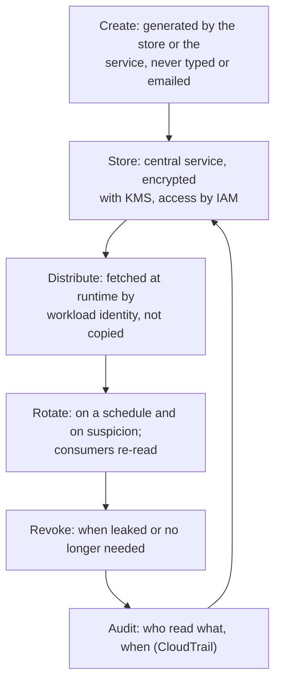

# Secrets management

> **Status: AI draft, 2026-11-16.** Not yet verified by me. Written from the OWASP Secrets Management Cheat Sheet, the Kubernetes good-practices guide and the tools' documentation; nothing was run.

## In one line

A secret is anything that grants access. Keep secrets out of Git, images, logs and plain manifests; store them centrally with access control and audit; prefer short-lived issued credentials; rotate in ways consumers pick up; and when one leaks, revoke first.

## The plain idea

Secrets are dangerous because they are portable: a copied key works from anywhere, for anyone, until someone changes it. Most leaks are mundane (a key in a commit, a token in a log line, a password baked into an image layer, a Secret YAML in a public repository) and most damage comes from keys that lived for years.

So the goals are: fewer secrets (use identity instead), shorter lives (expire automatically), fewer copies (one store, fetched at runtime), and a practised response when one escapes.

## How it works

### Where secrets must never be

| Place | Why it is bad |
|---|---|
| Git history | Forever visible to everyone with read access, and to every fork and clone |
| Container image layers | Anyone who can pull the image can read every layer, even if a later layer deletes the file ([Images and Dockerfiles](../containers/images-and-dockerfiles.md)) |
| Logs and CI output | Copied to log stores, tickets and screenshots; masking only catches exact matches ([Pipeline security](../cicd/pipeline-security.md)) |
| Plain values in manifests and Helm values | Kubernetes Secrets are base64, not encrypted ([ConfigMaps and Secrets](../kubernetes/configmaps-and-secrets.md)) |
| Environment variables of shell sessions and command lines | Visible in process listings and shell history ([Processes and signals](../linux/processes-and-signals.md)) |
| Chat messages and wiki pages | Searchable, retained, shared |

### The lifecycle

### Central stores and short-lived credentials

- **Central stores**: AWS Secrets Manager and Systems Manager Parameter Store, HashiCorp Vault, others. Encryption with KMS keys, IAM policies per secret path, audit in CloudTrail, built-in rotation for some secret types ([KMS and secrets stores](../aws-services/kms-and-secrets.md)).
- **Better than storing**: credentials issued on demand and expiring by themselves: IAM roles via STS, OIDC from CI, IRSA and Pod Identity for pods, database authentication through IAM, Vault's dynamic database credentials ([OIDC from pipelines to AWS](../cicd/oidc-to-aws.md), [Cluster access, IRSA and Pod Identity](../eks/access-and-pod-identity.md)).

### In Kubernetes

The options for getting store values into pods (External Secrets Operator, the Secrets Store CSI driver, SDK calls) are compared on [Secrets from AWS into pods](../eks/secrets.md). For GitOps, where everything else lives in Git:

| Tool | Idea | Notes |
|---|---|---|
| **External Secrets** | Git holds a reference; the value stays in the store | Most common with a cloud store |
| **Sealed Secrets** | Git holds a value encrypted with the cluster controller's public key; only the controller can decrypt it into a Secret | Self-contained; tied to that controller's key |
| **SOPS** | Encrypts the values in YAML or JSON files with KMS, age or PGP keys; keys stay readable for review | Works with Helm and Kustomize plugins and Argo CD integrations |

Whichever is used, RBAC on `get secrets` (and on creating pods, which can mount them) decides who can actually read the values ([RBAC and service accounts](../kubernetes/rbac-and-service-accounts.md)).

### Rotation only works if consumers re-read

Changing the value in the store does nothing for an application that read it once at startup. Plan rotation with the consumer: reload on change, short caches, rolling restarts, or two valid credentials during the switch (as Secrets Manager's alternating-users rotation does for databases) ([Secrets from AWS into pods](../eks/secrets.md)).

### When a secret leaks

1. **Revoke or rotate immediately**, before anything else. Assume it was copied the moment it was exposed.
2. Check the audit trail (CloudTrail, the provider's logs) for use since the exposure.
3. Remove it from where it leaked; rewriting Git history helps only for future clones and does not undo exposure.
4. Find how it got there and add a control: secret scanning in pre-commit and CI (gitleaks), push protection, log scrubbing ([Quality and security gates](../cicd/quality-and-security-gates.md)).

## A concrete example

A team's inventory and plan:

| Found | Replace with |
|---|---|
| IAM user access key in CI secrets | OIDC role for the pipeline |
| Database password in a Helm values file in Git | Secrets Manager secret with rotation, delivered by External Secrets; Git holds only the reference |
| API token for a third-party service, never rotated | Stored in Secrets Manager, rotated quarterly with a runbook, app reloads on change |
| SSH key shared by the team for bastion access | Session Manager with IAM, no key at all ([Systems Manager](../aws-services/systems-manager.md)) |
| Developers' long-lived personal keys | SSO with short sessions ([Federation and SSO](../aws-core/federation-and-sso.md)) |

## Why not just...?

- **...encrypt the secrets file and commit it with the key next to it?** Then the key is the secret, and it is in Git. Use a key held by KMS, a controller, or a person, never alongside.
- **...rotate everything every day?** Rotation that breaks consumers causes outages and gets turned off. Prefer short-lived issued credentials, and rotate stored ones at a pace your consumers handle.
- **...rely on base64 in Kubernetes Secrets?** Base64 is encoding, not encryption. Protect Secrets with RBAC, encryption at rest, and an external store.

## Commands to know

| Command | What it does |
|---|---|
| `gitleaks git --redact` | Scan Git history for secrets. |
| `gitleaks dir .` | Scan the working tree before committing. |
| `aws secretsmanager describe-secret --secret-id <id>` | Rotation configuration and last rotation date. |
| `aws secretsmanager rotate-secret --secret-id <id>` | Rotate now. |
| `kubectl auth can-i get secrets -n <ns> --as=<user>` | Who can read Secrets in a namespace. |
| `sops --encrypt --kms <key-arn> secrets.yaml > secrets.enc.yaml` | Encrypt values in a file with a KMS key. |

## How it breaks

| Symptom | Layer | Check | Likely cause |
|---|---|---|---|
| Key found in a public repository | Storage | Git history | Committed by mistake; no pre-commit or push scanning |
| App fails right after rotation | Rotation | How the app reads it | Cached at startup; no reload; single-user rotation |
| Unexpected API usage on a cloud account | Leak | CloudTrail by access key | Long-lived key leaked; revoke and investigate |
| Secret visible in CI logs | Output | The step that printed it | Echoed or transformed value not masked |
| Too many people can read production secrets | Access | IAM and RBAC policies | Broad wildcards, shared roles |

## Interview questions

**1. Where should secrets never be stored?**

Answer

- Git history, image layers, logs, plain Kubernetes manifests or Helm values.
- Command lines, shell history, chat and wikis.
- Use a central store or, better, issued short-lived credentials.

**2. Describe the secret lifecycle.**

Answer

- Create (generated, never shared by hand), store (central, encrypted, access-controlled), distribute (fetched at runtime by identity).
- Rotate (scheduled and on suspicion), revoke (on leak or end of use).
- Audit every access.

**3. How do you manage secrets with GitOps?**

Answer

- Keep values out of Git: references (External Secrets) or encrypted values (Sealed Secrets, SOPS).
- The decryption key or store access sits with a controller in the cluster, not in Git.
- RBAC limits who can read the resulting Secrets.

**4. Why can rotating a secret break an application, and how do you avoid it?**

Answer

- The app may cache the old value or read it only at startup; the old credential stops working immediately.
- Use reload on change, short caches or rolling restarts, and two-credential rotation for databases.
- Test rotation in staging.

**5. A developer pushed an AWS access key to GitHub. What do you do?**

Answer

- Deactivate and delete the key immediately; issue a new credential only if still needed (better: move to roles).
- Check CloudTrail for use of that key since the push.
- Clean the repository, then add scanning and push protection.

**6. What is better than a well-managed long-lived secret?**

Answer

- No stored secret: credentials issued on demand from an identity (IAM roles, OIDC, IRSA, IAM database auth).
- They expire by themselves and cannot be copied for long-term use.
- Keep stored secrets only where the other side cannot accept identity-based access.

## Try it

1. Run `gitleaks dir .` (or the pre-push hook of this repository) on a project and look at what it finds.
2. List every secret one of your applications uses, and next to each, whether it could be replaced by an identity-based credential.
3. Write the rotation steps for a database password used by three services, keeping them all working throughout.

## Zoom out

Secrets management is one of the foundations under pipelines, Kubernetes and AWS access: most other security pages assume it is done well ([Pipeline security](../cicd/pipeline-security.md), [Secrets from AWS into pods](../eks/secrets.md), [Hardening and benchmarks](hardening-and-benchmarks.md)).

## Sources

- [OWASP: Secrets Management Cheat Sheet](https://cheatsheetseries.owasp.org/cheatsheets/Secrets_Management_Cheat_Sheet.html)
- [Kubernetes documentation: good practices for Secrets](https://kubernetes.io/docs/concepts/security/secrets-good-practices/)
- [AWS Secrets Manager: rotating secrets](https://docs.aws.amazon.com/secretsmanager/latest/userguide/rotating-secrets.html)
- [SOPS documentation](https://getsops.io/docs/)
- [Sealed Secrets](https://github.com/bitnami/sealed-secrets)
- [GitHub Docs: secret scanning](https://docs.github.com/en/code-security/concepts/secret-security/secret-scanning)
