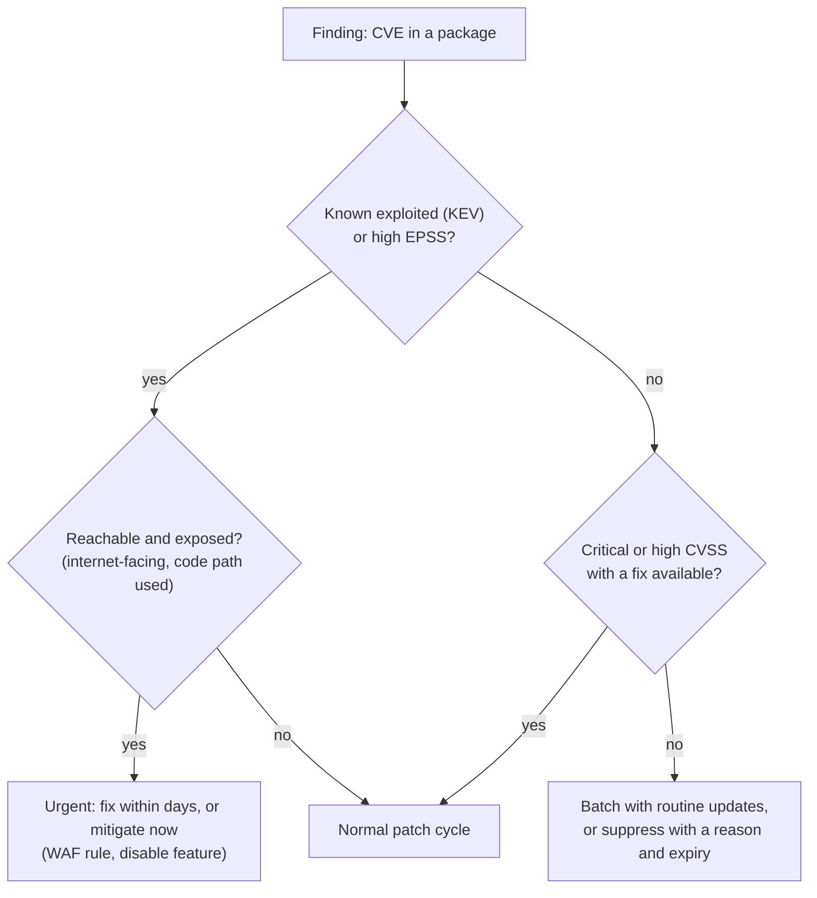

# Vulnerability and patch management

> **Status: AI draft, 2026-11-16.** Not yet verified by me. Written from the CVE, FIRST (CVSS, EPSS), CISA and AWS documentation; nothing was run.

## In one line

Scan hosts, images and dependencies continuously; rank findings by known exploitation (KEV, EPSS), exposure and fix availability rather than CVSS alone; fix by rebuilding images and replacing hosts; and measure time to remediate.

## The plain idea

New vulnerabilities are published every day in software you already run: the OS, the base image, the language runtime, every library. You cannot fix all of them immediately, so the job is to find them continuously, decide which ones actually matter for *your* systems, fix those fast and safely, and show that you did.

## How it works

### The vocabulary

| Term | Meaning |
|---|---|
| **CVE** | A public identifier for one vulnerability (`CVE-<year>-<number>`), with a description and affected versions |
| **CVSS** | A 0 to 10 severity score from the vulnerability's characteristics (attack vector, complexity, privileges, impact). Says how bad it *could* be, not how likely |
| **EPSS** | FIRST's model estimating the probability a CVE will be exploited in the wild in the next 30 days |
| **KEV** | CISA's Known Exploited Vulnerabilities catalogue: CVEs with evidence of active exploitation |
| **Fix available** | Whether a patched version of the package exists |

### Where to scan

| Target | Tools | When |
|---|---|---|
| Container images | Trivy, ECR scanning, Inspector ([ECR](../aws-services/ecr.md)) | On build (gate), on push, and continuously for running images |
| Dependencies (lock files, SBOMs) | Trivy, Dependabot, other SCA tools | Every pull request, and nightly |
| Hosts (EC2, nodes) | Inspector, Systems Manager Patch Manager compliance ([Systems Manager](../aws-services/systems-manager.md)) | Continuously |
| IaC and configuration | Trivy config, Checkov ([Testing and CI for Terraform](../iac/testing-and-ci.md)) | Every pull request |

Continuous scanning matters because a clean image becomes vulnerable the day a new CVE is published against something inside it.

### Triage

Questions that change priority: Is the vulnerable code actually used? Is the service internet-facing? Is there a fix? Is it being exploited? A CVSS 9.8 in a library function you never call, in an internal batch job, can wait; a CVSS 7 on the internet-facing ingress, listed in KEV, cannot.

### Fixing: rebuild, do not patch in place

| Approach | For | How |
|---|---|---|
| **Rebuild and redeploy** | Containers | Update the base image and dependencies, rebuild, roll out through the pipeline ([Images and Dockerfiles](../containers/images-and-dockerfiles.md)) |
| **Replace hosts** | Immutable nodes and instances | New AMI, then rolling replacement: node group update, Karpenter drift, ASG instance refresh ([EKS upgrades](../eks/upgrades.md), [Auto Scaling and AMIs](../aws-services/auto-scaling-and-amis.md)) |
| **Patch in place** | Long-lived servers | Patch Manager with baselines and maintenance windows ([Packages and updates](../linux/packages-and-updates.md)) |

Safe patching: patch windows that match the service's quiet hours, canary hosts or a staging environment first, health checks, and a way back (the previous image or AMI).

### Suppressions with reasons

Some findings are not exploitable in context, or have no fix yet. Record each exception in the scanner's ignore file with: the CVE, why it does not apply or what mitigates it, who decided, and an expiry date to re-check. A suppression without an expiry becomes permanent blindness.

### Measuring

- **Time to remediate** by severity class (median and 90th percentile), compared with your policy (for example critical in 7 days, high in 30).
- Open findings by age and by service.
- Share of images rebuilt in the last N days.

## A concrete example

A critical CVE in a widely used library is published and added to KEV the next day:

1. Scanners flag 12 images; SBOMs show which services include the library ([Pipeline security](../cicd/pipeline-security.md)).
2. Triage: three internet-facing services use the vulnerable feature, so they are urgent; nine internal ones go in the normal cycle.
3. Short-term mitigation for the three: a WAF rule blocking the exploit pattern ([CloudFront and WAF](../aws-core/cloudfront-and-waf.md)).
4. Library updated, images rebuilt and rolled out through the normal pipeline within two days, staging first.
5. The image gate now fails on this CVE so no new image ships with it ([Quality and security gates](../cicd/quality-and-security-gates.md)).

## Why not just...?

- **...fix strictly by CVSS score?** CVSS ignores whether the code is reachable, exposed, or exploited. You spend time on unexploitable criticals while an exploited high waits.
- **...`apt upgrade` inside running containers?** The change disappears on the next restart, and the image in the registry is still vulnerable. Rebuild the image.
- **...suppress everything without a fix?** Fixes arrive later, and the suppression hides them. Give suppressions expiry dates.

## Commands to know

| Command | What it does |
|---|---|
| `trivy image --severity HIGH,CRITICAL --ignore-unfixed <image>` | Fixable high and critical findings in an image. |
| `trivy image --format cyclonedx --output sbom.json <image>` | SBOM for later "are we affected?" checks. |
| `trivy sbom sbom.json` | Re-scan an SBOM against today's vulnerability data. |
| `aws inspector2 list-findings --filter-criteria ...` | Findings from Amazon Inspector. |
| `aws ssm describe-instance-patch-states --instance-ids <id>` | Patch compliance of an instance. |
| `apt list --upgradable` | Pending package updates on a Debian or Ubuntu host. |

## How it breaks

| Symptom | Layer | Check | Likely cause |
|---|---|---|---|
| Same CVE keeps reappearing | Fix path | Base image and build | Fixed in place, not in the image; base image not updated |
| Thousands of findings, nothing gets fixed | Triage | Prioritisation | Ranked by CVSS only; no exploitability or exposure filter |
| Exploited CVE missed | Coverage | Scanning targets | Running images never rescanned after deploy |
| Patching caused an outage | Process | Patch window, canaries | Patched everything at once without a canary or rollback |
| Suppressed finding was later exploitable | Suppressions | Expiry dates | Permanent suppression without review |

## Interview questions

**1. What are CVE, CVSS, EPSS and KEV?**

Answer

- CVE: the identifier of a known vulnerability.
- CVSS: a 0 to 10 severity score of potential impact.
- EPSS: probability of exploitation in the next 30 days; KEV: CISA's list of vulnerabilities known to be exploited.

**2. How do you prioritise vulnerability findings?**

Answer

- Known exploitation (KEV) or high EPSS first, then exposure (internet-facing) and reachability.
- Then severity with a fix available.
- Suppress the rest only with reasons and expiry.

**3. How do you patch containers?**

Answer

- Update the base image and dependencies, rebuild, scan, and roll out through the pipeline.
- Never patch inside running containers.
- Rescan running images continuously for new CVEs.

**4. How do you patch a fleet of EC2 instances or EKS nodes safely?**

Answer

- Prefer new AMIs and rolling replacement (node group update, Karpenter drift, ASG instance refresh).
- For long-lived servers, Patch Manager with baselines and maintenance windows.
- Canary first, health checks, and a rollback path.

**5. What metrics show whether vulnerability management works?**

Answer

- Time to remediate by severity against policy targets.
- Open findings by age and service; age of running images.
- Number of suppressions past their expiry.

**6. A critical CVE is announced in a base image used everywhere. Walk through your response.**

Answer

- Find affected images and running services (SBOMs, registry scans); check exploitation status and exposure.
- Mitigate the exposed ones immediately if a fix is not ready; update the base image and rebuild in priority order.
- Add a gate so nothing new ships with it; track until all are redeployed.

## Try it

1. Scan a public image you use with Trivy, and sort the findings into the triage boxes of the diagram above.
2. Write a suppression entry for one finding, with reason and expiry.
3. Draft a remediation policy table: severity, exploited or not, internet-facing or not, and target days.

## Zoom out

Vulnerability management ties together image builds, pipelines, host lifecycle and policy ([Images and Dockerfiles](../containers/images-and-dockerfiles.md), [Quality and security gates](../cicd/quality-and-security-gates.md), [Hardening and benchmarks](hardening-and-benchmarks.md)). Immutable infrastructure makes it routine: fixing is rebuilding, and rebuilding is what the pipeline does every day.

## Sources

- [CVE program: overview](https://www.cve.org/About/Overview)
- [FIRST: Common Vulnerability Scoring System](https://www.first.org/cvss/)
- [FIRST: Exploit Prediction Scoring System](https://www.first.org/epss/)
- [CISA: Known Exploited Vulnerabilities catalog](https://www.cisa.gov/known-exploited-vulnerabilities-catalog)
- [AWS Systems Manager: Patch Manager](https://docs.aws.amazon.com/systems-manager/latest/userguide/patch-manager.html)
- [Amazon Inspector](https://docs.aws.amazon.com/inspector/latest/user/what-is-inspector.html)
- [Trivy documentation: filtering and ignoring findings](https://trivy.dev/docs/latest/guide/configuration/filtering/)
