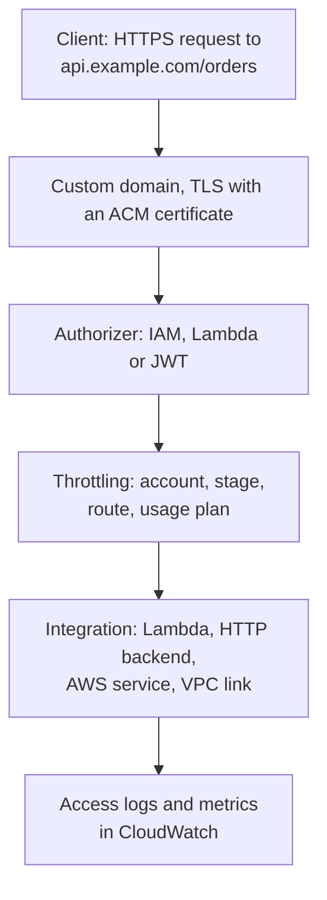

# API Gateway

> **Status: AI draft, 2026-11-16.** Not yet verified by me. Written from the Amazon API Gateway Developer Guide; no AWS calls were made.

## In one line

API Gateway is a managed front door for APIs: it terminates HTTPS, authenticates (IAM, Lambda or JWT authorizers), throttles, and forwards to Lambda, HTTP backends, AWS services or VPC links. REST APIs have most features, HTTP APIs are simpler, and integrations must answer within about 30 seconds.

## The plain idea

A backend function or service should not have to deal with TLS certificates, authentication, rate limiting, request logging and routing for every endpoint. API Gateway does those once, at the edge of your system, and forwards clean requests to whatever does the work: most often a Lambda function, but also HTTP services and AWS APIs directly ([Load balancers and proxies](../networking/load-balancers-and-proxies.md)).

## How it works

### API types

| | REST API | HTTP API | WebSocket API |
|---|---|---|---|
| For | Full-featured REST APIs | Simple, lower-cost APIs and proxies | Two-way, long-lived connections (chat, live updates) |
| Endpoint types | Edge-optimized, Regional, private | Regional | Regional |
| Authorizers | IAM, Lambda, Cognito user pools | IAM, Lambda, JWT (any OIDC issuer) | IAM, Lambda |
| API keys and usage plans | Yes | No | No |
| AWS WAF | Yes | No | No |
| Request validation and transformation | Yes | Limited (parameter mapping) | Route selection |
| Integration timeout | 50 ms to 29 s (can be raised for Regional and private APIs) | Up to 30 s | |

AWS's guidance: choose REST APIs if you need API keys, per-client throttling, request validation, WAF or private endpoints; otherwise HTTP APIs.

### Stages and deployments

- REST APIs are changed in a working copy and published by creating a **deployment** to a **stage** (`dev`, `prod`); each stage has its own URL, settings, variables and logs. Forgetting to deploy is a classic "my change is not live" cause.
- HTTP APIs can auto-deploy to a stage on every change.

### Integrations

| Integration | What happens |
|---|---|
| **Lambda proxy** | The whole request goes to the function as an event; the function must return `statusCode`, `headers` and `body` in the expected shape ([Lambda](lambda.md)) |
| **HTTP proxy** | Forwarded to a public HTTP endpoint |
| **AWS service** | Calls an AWS API directly (for example SQS `SendMessage`) with an IAM role, no function needed |
| **VPC link** | Reaches private resources (an NLB or ALB, or Cloud Map services) in your VPC ([ALB and NLB](../aws-core/load-balancers.md)) |

### Authorizers

- **IAM**: callers sign requests with SigV4; good for service-to-service inside AWS.
- **JWT** (HTTP APIs) or **Cognito user pool** (REST APIs): validates tokens from an OIDC issuer: signature, issuer, audience, expiry, scopes ([OAuth 2.0, OIDC and JWTs](../security/oauth-oidc-jwt.md), [Cognito](cognito.md)).
- **Lambda authorizer**: your function decides (custom tokens, API keys in a database), returning an IAM policy or a simple allow; results can be cached.
- API keys are for identifying clients in usage plans, not for authentication.

### Throttling and usage plans

- An account-level throttle per region (10,000 requests per second by default, with a burst bucket; lower in some regions; raisable) is shared by all APIs. Excess requests get `429 Too Many Requests`.
- Stage and route (or method) limits set tighter caps.
- **Usage plans** (REST) give each API key its own rate, burst and quota (per day or month).

### Custom domains and certificates

Map `api.example.com` to API stages with base path mappings. Regional APIs use an ACM certificate in the same region; edge-optimized APIs (served through CloudFront) need the certificate in `us-east-1` ([Route 53 and ACM](../aws-core/route53-and-acm.md)).

### Logging

- **Access logs** (one line per request, format you define: request ID, IP, route, status, latency, integration latency, error message) to CloudWatch Logs or Firehose.
- **Execution logs** (REST): detailed request processing, useful for debugging, noisy in production.
- Metrics: `Count`, `4XXError`, `5XXError`, `Latency`, `IntegrationLatency` ([CloudWatch](../aws-services/cloudwatch.md)).

## A concrete example

`sample-app`'s public API:

1. HTTP API, Regional, custom domain `api.example.com` with an ACM certificate in `ap-south-1`.
2. Routes `GET /orders` and `POST /orders` to a Lambda proxy integration on the function's `prod` alias.
3. JWT authorizer with the Cognito user pool as issuer and the app client as audience; `POST` requires the `orders/write` scope.
4. Route throttling for `POST /orders`; access logs with request ID and integration latency.
5. A partner integration that needs per-client quotas gets a separate REST API with usage plans and API keys, plus WAF.

## Why not just...?

- **...expose Lambda function URLs or an ALB instead?** Function URLs and ALBs are simpler and fine for many cases, but lack API Gateway's authorizers, usage plans, request validation and per-route throttling. Pick by the features you need.
- **...use API keys as authentication?** They are easily shared and not tied to an identity. Use JWT, IAM or a Lambda authorizer; keep keys for metering.
- **...run long synchronous operations behind the API?** The integration timeout (about 29–30 seconds) ends the request. Return `202 Accepted` and process asynchronously ([SQS, SNS and EventBridge](../aws-services/messaging.md), [Step Functions](step-functions.md)).

## Commands to know

These were not run for this page.

| Command | What it does |
|---|---|
| `aws apigatewayv2 get-apis` | HTTP and WebSocket APIs. |
| `aws apigateway get-rest-apis` | REST APIs. |
| `aws apigateway create-deployment --rest-api-id <id> --stage-name prod` | Publish REST API changes to a stage. |
| `aws apigateway get-stage --rest-api-id <id> --stage-name prod` | Stage settings, logging, throttling. |
| `curl -v -H "Authorization: Bearer $TOKEN" https://api.example.com/orders` | Test a route with a token ([curl -v line by line](../networking/curl-v-annotated.md)). |
| `aws logs tail <access-log-group> --follow` | Watch access logs. |

## How it breaks

| Symptom | Layer | Check | Likely cause |
|---|---|---|---|
| `403 {"message":"Missing Authentication Token"}` | Routing | Path, method, stage name in the URL | Wrong path or method, or stage missing from the URL; not usually an auth problem |
| `401 Unauthorized` or `403 Forbidden` from the authorizer | Authorizer | Token issuer, audience, scopes, expiry | Wrong audience or issuer configured, expired token, missing scope |
| `502 Bad Gateway`, "Malformed Lambda proxy response" | Integration | The function's return value | Function returned the wrong shape (no `statusCode`, non-string `body`) or crashed |
| `504 Gateway Timeout`, endpoint request timed out | Integration | `IntegrationLatency` | Backend slower than the integration timeout |
| `429 Too Many Requests` | Throttling | Account, stage, route limits, usage plan | Limits reached |
| Change not visible | Deployment | Last deployment time | REST API change not deployed to the stage |

## Interview questions

**1. REST API or HTTP API?**

Answer

- REST: API keys and usage plans, WAF, request validation, private and edge-optimized endpoints.
- HTTP: simpler, cheaper, native JWT authorizers, auto-deploy.
- Choose REST only when you need its features.

**2. What authorizer options are there?**

Answer

- IAM (SigV4) for AWS callers.
- JWT (HTTP API) or Cognito user pools (REST) for OIDC tokens.
- Lambda authorizers for custom logic, with caching.

**3. A client gets "Missing Authentication Token". What is wrong?**

Answer

- Usually the request does not match any route: wrong path, method or stage.
- Compare the URL with the deployed routes; for REST, check the change was deployed.
- It is rarely about a missing token despite the message.

**4. A Lambda-backed API returns 502. What do you check?**

Answer

- The function's logs: did it crash, time out or return the wrong response shape?
- For proxy integrations, the response must contain `statusCode`, `headers` and a string `body`.
- Permissions: can API Gateway invoke the function (resource-based policy)?

**5. How do you handle an operation that takes two minutes?**

Answer

- Not synchronously: the integration times out at about 29–30 seconds.
- Accept the request, enqueue the work (SQS, Step Functions), return 202 with a job ID.
- The client polls or receives a callback or WebSocket message.

**6. How do you protect an API from one noisy client?**

Answer

- Usage plans with API keys per client (REST): rate, burst and quota.
- Route-level throttling; WAF rate-based rules.
- Monitor 429s per client and route.

## Try it

Without AWS:

1. Write the Lambda proxy response for a successful `GET /orders` returning a JSON list.
2. For each error in the "How it breaks" table, write the first log or metric you would look at.
3. Decide REST or HTTP API for: a public mobile backend, a partner API with per-client quotas, an internal service called by other AWS services.

## Zoom out

API Gateway is the serverless counterpart of a load balancer and ingress controller: TLS, routing and auth in front of compute ([Ingress and Gateway API](../kubernetes/ingress-and-gateway-api.md), [AWS Load Balancer Controller](../eks/load-balancer-controller.md)). With Lambda and Cognito it forms the common serverless web stack.

## Sources

- [API Gateway Developer Guide: choose between REST APIs and HTTP APIs](https://docs.aws.amazon.com/apigateway/latest/developerguide/http-api-vs-rest.html)
- [API Gateway Developer Guide: quotas](https://docs.aws.amazon.com/apigateway/latest/developerguide/limits.html)
- [API Gateway Developer Guide: REST API quotas (integration timeout)](https://docs.aws.amazon.com/apigateway/latest/developerguide/api-gateway-execution-service-limits-table.html)
- [API Gateway Developer Guide: HTTP API quotas](https://docs.aws.amazon.com/apigateway/latest/developerguide/http-api-quotas.html)
- [API Gateway Developer Guide: throttling](https://docs.aws.amazon.com/apigateway/latest/developerguide/api-gateway-request-throttling.html)
- [API Gateway Developer Guide: Lambda proxy integrations](https://docs.aws.amazon.com/apigateway/latest/developerguide/set-up-lambda-proxy-integrations.html)
- [API Gateway Developer Guide: JWT authorizers](https://docs.aws.amazon.com/apigateway/latest/developerguide/http-api-jwt-authorizer.html)
- [API Gateway Developer Guide: custom domain names](https://docs.aws.amazon.com/apigateway/latest/developerguide/how-to-custom-domains.html)
- [API Gateway Developer Guide: logging](https://docs.aws.amazon.com/apigateway/latest/developerguide/set-up-logging.html)
- [API Gateway Developer Guide: usage plans](https://docs.aws.amazon.com/apigateway/latest/developerguide/api-gateway-api-usage-plans.html)
