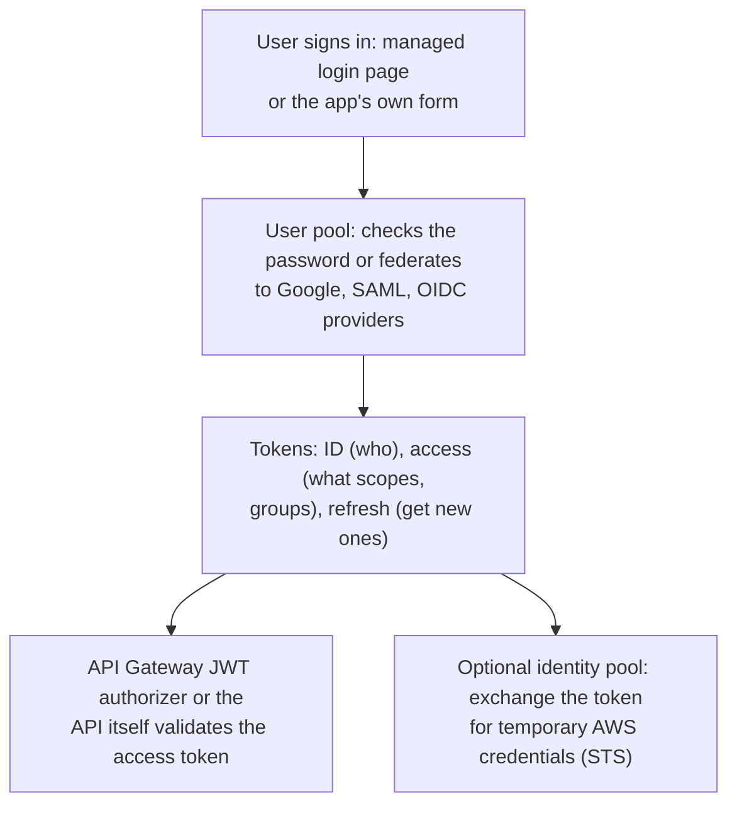

# Cognito

> **Status: AI draft, 2026-11-16.** Not yet verified by me. Written from the Amazon Cognito Developer Guide; no AWS calls were made.

## In one line

Cognito user pools are a managed user directory and OIDC identity provider: users sign up and sign in (directly, through managed login pages, or via social and enterprise providers) and apps receive ID, access and refresh tokens. Identity pools are a separate feature that exchanges an identity for temporary AWS credentials.

## How it works

| Feature | What it is |
|---|---|
| **User pool** | Directory of users, password policies, MFA, sign-up flows, and an OAuth 2.0 / OIDC authorization server ([OAuth 2.0, OIDC and JWTs](../security/oauth-oidc-jwt.md)) |
| **App client** | One registered application: allowed OAuth flows (authorization code with PKCE for apps, client credentials for machines), callback URLs, scopes, token lifetimes, with or without a client secret |
| **Managed login** (formerly the hosted UI) | Cognito-hosted sign-in and sign-up pages on a Cognito or custom domain, so the app never handles passwords |
| **Federation** | Sign-in through social providers or enterprise SAML and OIDC identity providers, with users linked into the pool |
| **Groups** | Users in groups appear in the `cognito:groups` claim of both ID and access tokens; a group can also map to an IAM role |
| **Identity pool** | Exchanges a user pool token (or other identities, or guest access) for temporary AWS credentials, so a mobile app can call S3 directly with limited rights ([IAM roles and STS](../aws-core/iam-roles-and-sts.md)) |

**Tokens**: the **ID token** carries identity claims (username, email) for the app; the **access token** carries scopes and groups for APIs; the **refresh token** obtains new ID and access tokens and can be revoked to cut off a session. All are JWTs signed with keys published at the pool's JWKS endpoint.

**As an API authorizer**: an HTTP API's JWT authorizer (or a REST API's Cognito authorizer) uses the user pool as issuer and the app client ID as audience, and can require scopes per route. The backend then trusts `sub`, scopes and `cognito:groups` from the validated token ([API Gateway](api-gateway.md)).

## Interview questions

**1. What is the difference between a user pool and an identity pool?**

Answer

- User pool: user directory and OIDC provider that authenticates users and issues JWTs.
- Identity pool: exchanges an identity (often a user pool token) for temporary AWS credentials.
- Many apps use only a user pool plus an API authorizer.

**2. Which tokens does a user pool issue, and what is each for?**

Answer

- ID token: who the user is, for the client.
- Access token: scopes and groups, for APIs.
- Refresh token: obtain new tokens; revoke it to end a session.

**3. How do you protect an API with Cognito?**

Answer

- A JWT authorizer (HTTP API) or Cognito authorizer (REST API) with the user pool as issuer and the app client as audience.
- Require scopes per route; use groups for coarse roles.
- The API trusts claims only after validation.

**4. How do you give admins extra rights?**

Answer

- Put them in a user pool group; the `cognito:groups` claim appears in their tokens.
- The API or authorizer checks the group; or the group maps to an IAM role through an identity pool.
- Keep the authorisation decision in one place.

**5. Why use managed login instead of building your own sign-in form?**

Answer

- The app never handles passwords; MFA, password reset and federation come built in.
- It follows the OAuth authorization code flow with PKCE.
- Less security-sensitive code to write and maintain.

## Sources

- [Amazon Cognito Developer Guide: what is Amazon Cognito](https://docs.aws.amazon.com/cognito/latest/developerguide/what-is-amazon-cognito.html)
- [Amazon Cognito Developer Guide: user pool tokens](https://docs.aws.amazon.com/cognito/latest/developerguide/amazon-cognito-user-pools-using-tokens-with-identity-providers.html)
- [Amazon Cognito Developer Guide: app clients](https://docs.aws.amazon.com/cognito/latest/developerguide/user-pool-settings-client-apps.html)
- [Amazon Cognito Developer Guide: managed login](https://docs.aws.amazon.com/cognito/latest/developerguide/cognito-user-pools-managed-login.html)
- [Amazon Cognito Developer Guide: user pool groups](https://docs.aws.amazon.com/cognito/latest/developerguide/cognito-user-pools-user-groups.html)
- [Amazon Cognito Developer Guide: identity pools](https://docs.aws.amazon.com/cognito/latest/developerguide/cognito-identity.html)
