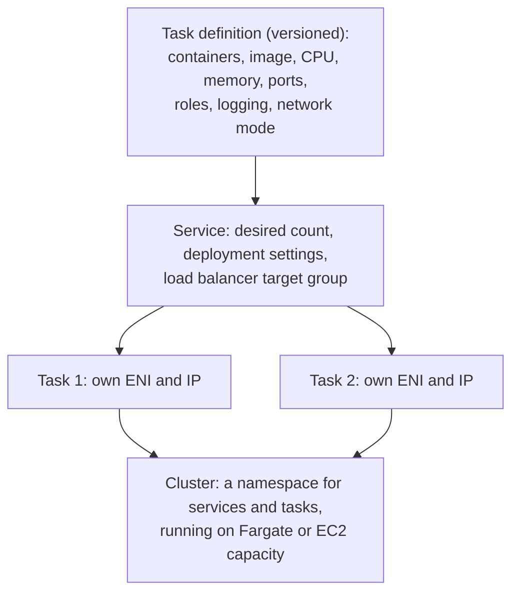

# ECS and Fargate

> **Status: AI draft, 2026-11-16.** Not yet verified by me. Written from the Amazon ECS Developer Guide and the AWS container decision guide; no AWS calls were made.

## In one line

ECS runs containers from versioned task definitions; a service keeps N tasks running behind a load balancer and rolls out new versions. Tasks run on Fargate or your EC2 instances, each with its own network interface, an execution role for ECS and a task role for your code.

## The plain idea

ECS is AWS's own container orchestrator: simpler than Kubernetes, with fewer concepts and deep AWS integration. You describe a container setup once (image, CPU, memory, ports, environment, logging), ask ECS to keep some number of copies running, and ECS places, restarts and replaces them. **Fargate** removes the servers too: each task gets its own isolated compute, sized by the task definition.

## How it works

### The objects

| Object | Meaning | Kubernetes analogy |
|---|---|---|
| **Cluster** | Logical grouping of services and tasks, with capacity providers | A cluster |
| **Task definition** | A versioned blueprint of one or more containers | A pod spec |
| **Task** | A running instance of a task definition | A pod |
| **Service** | Keeps a desired number of tasks running, replaces failed ones, integrates with load balancers, rolls out new revisions | A Deployment plus Service |

### Fargate vs EC2 launch type

| | Fargate | EC2 capacity |
|---|---|---|
| Servers | None to manage; each task isolated | You run the instances (Auto Scaling group, ECS-optimized AMI), patch and scale them |
| Sizing | CPU and memory per task | Bin-pack tasks onto instances you choose |
| Features | Some host-level features unavailable (privileged containers, host network) | Full control: GPUs, custom AMIs, daemons |
| Cost | Per task vCPU and memory per second | Per instance, cheaper when packed well; Spot available on both |
| Fits | Most services, especially smaller teams | Large steady fleets, special hardware, host-level agents |

Capacity providers let a service mix them, for example Fargate Spot for some tasks ([Cost optimisation](../operations/cost-optimisation.md)).

### Networking: awsvpc

With the `awsvpc` network mode (required on Fargate), every task gets its own elastic network interface, private IP and security groups, like a small instance. Consequences:

- Security groups apply per task, not per host ([Security groups and NACLs](../aws-core/security-groups-and-nacls.md)).
- Load balancer target groups must use target type `ip`, not `instance` ([ALB and NLB](../aws-core/load-balancers.md)).
- Each task consumes a subnet address; size subnets for peak task counts ([IP addresses and subnetting](../networking/ip-and-subnetting.md)).
- Tasks in private subnets need NAT or VPC endpoints to pull images from ECR and write logs ([NAT, endpoints and PrivateLink](../aws-core/nat-endpoints-privatelink.md)).

### Two roles

| Role | Used by | Needs |
|---|---|---|
| **Task execution role** | The ECS agent / Fargate, to start the task | Pull from ECR, write to CloudWatch Logs, read secrets referenced in the task definition |
| **Task role** | Your application code inside the containers | Whatever the app calls: S3, DynamoDB, SQS |

Mixing them up is a classic error: the image pulls fine but the app gets AccessDenied (task role missing), or the task never starts because it cannot pull or fetch a secret (execution role missing) ([IAM roles and STS](../aws-core/iam-roles-and-sts.md)).

### Deployments

- **Rolling update**, controlled by `minimumHealthyPercent` and `maximumPercent`: how many tasks may be below desired count, and how many extra may run during the rollout ([Deployment strategies](../cicd/deployment-strategies.md)).
- **Deployment circuit breaker**: detects a deployment whose tasks keep failing to reach a healthy state and, with rollback enabled, returns the service to the last completed deployment.
- Blue-green deployments are also available (natively, or through CodeDeploy).
- Health: container health checks plus load balancer target health decide when a task counts as healthy.

### Logging and access

- `awslogs` log driver sends container stdout and stderr to CloudWatch Logs; **FireLens** runs Fluent Bit as a sidecar to route logs elsewhere ([Fluent Bit](../observability/fluent-bit.md)).
- **ECS Exec** opens a shell or runs a command in a running container through Systems Manager, without SSH or open ports; it needs to be enabled on the service and allowed by the task role ([Systems Manager](../aws-services/systems-manager.md)).

### ECS or EKS?

| Choose ECS when | Choose EKS when |
|---|---|
| The team wants the least to operate and is all-in on AWS | You need the Kubernetes ecosystem (Helm charts, operators, Argo CD, service meshes) |
| Services are fairly standard web and worker containers | Portability across clouds or on-premises matters |
| No Kubernetes skills in the team | The team already runs Kubernetes |

## A concrete example

`sample-app`'s worker on ECS with Fargate:

1. Task definition: one container from ECR, 0.5 vCPU and 1 GB, `awslogs` to `/ecs/sample-worker`, a secret from Secrets Manager injected as an environment variable.
2. Execution role: ECR pull, CloudWatch Logs, `secretsmanager:GetSecretValue` on that secret. Task role: SQS receive and delete on its queue, S3 put on one prefix.
3. Service in three private subnets with security group `sg-worker`, desired count 3, `minimumHealthyPercent` 100, `maximumPercent` 200, circuit breaker with rollback.
4. Service auto scaling on the SQS queue depth.
5. ECS Exec enabled for debugging; no SSH anywhere.

## Why not just...?

- **...give the task execution role the app's permissions too?** Then the ECS agent and your code share one broad role. Keep the roles separate and minimal.
- **...use EC2 launch type to save money from day one?** You take on patching, scaling and bin-packing of instances. Start with Fargate; move steady, large fleets to EC2 capacity when the numbers justify it.
- **...SSH into tasks to debug?** Fargate has no host to SSH into, and open SSH ports are a risk. Use ECS Exec with audit logging.

## Commands to know

These were not run for this page.

| Command | What it does |
|---|---|
| `aws ecs list-services --cluster sample-cluster` | Services in a cluster. |
| `aws ecs describe-services --cluster sample-cluster --services sample-worker` | Desired, running and pending counts, deployments, events. |
| `aws ecs describe-tasks --cluster sample-cluster --tasks <task-arn>` | Task state and `stoppedReason`. |
| `aws ecs update-service --cluster sample-cluster --service sample-worker --task-definition sample-worker:42` | Deploy a new revision. |
| `aws ecs execute-command --cluster sample-cluster --task <task-id> --container app --interactive --command "/bin/sh"` | Shell into a running container. |
| `aws logs tail /ecs/sample-worker --follow` | Follow container logs. |

## How it breaks

| Symptom | Layer | Check | Likely cause |
|---|---|---|---|
| Task stops with `CannotPullContainerError` | Image pull | `stoppedReason`, execution role, network path | No ECR permission in the execution role, or no route to ECR from private subnets |
| `ResourceInitializationError` fetching secrets | Execution role | Role permissions, network | Execution role cannot read the secret, or no path to Secrets Manager |
| App gets AccessDenied | Task role | Task role policy | Permissions put on the execution role instead |
| Tasks start and stop repeatedly, deployment rolls back | Health | Container logs, target health | App crashing, health check path wrong, circuit breaker triggered |
| Service cannot place tasks | Capacity, network | Service events | No capacity, or subnets out of addresses |
| Load balancer shows no healthy targets | Target type, security groups | Target group | Target type `instance` with awsvpc, or task security group blocks the ALB |

## Interview questions

**1. Explain cluster, task definition, task and service.**

Answer

- Task definition: versioned blueprint of containers; task: a running copy.
- Service: keeps a desired number of tasks running, handles deployments and load balancer registration.
- Cluster: the grouping and capacity they run on.

**2. What is the difference between the task execution role and the task role?**

Answer

- Execution role: used by ECS or Fargate to pull images, write logs and fetch secrets at start.
- Task role: used by the application code for its own AWS calls.
- Errors at startup point to the first; AccessDenied from the app points to the second.

**3. What does the awsvpc network mode change?**

Answer

- Each task gets its own ENI, private IP and security groups.
- Load balancer targets must be `ip`; each task uses a subnet address.
- Private subnets need NAT or endpoints for ECR and logs.

**4. Fargate or EC2 launch type?**

Answer

- Fargate: no servers, per-task isolation and billing; fewer host-level features.
- EC2: control and potentially lower cost at scale, but you manage instances.
- Many teams start on Fargate and move large steady fleets to EC2 capacity.

**5. How do ECS rolling deployments and the circuit breaker work?**

Answer

- `minimumHealthyPercent` and `maximumPercent` bound how many tasks are replaced at once.
- New tasks must become healthy (container and load balancer checks) before old ones go.
- The circuit breaker stops a deployment whose tasks keep failing and, with rollback on, returns to the last completed deployment.

**6. A new task revision never becomes healthy. How do you debug it?**

Answer

- Service events and stopped tasks' `stoppedReason`.
- Container logs in CloudWatch; target group health and health check path.
- Roles (execution vs task), secrets access, and network path from the subnets.

## Try it

Without AWS:

1. Write a task definition (JSON) for a single container with `awsvpc`, `awslogs` and one secret.
2. Write the two IAM policies (execution and task role) for it.
3. Map each ECS object to its Kubernetes counterpart and note one thing that has no equivalent.

## Zoom out

ECS sits between Lambda and EKS on the managed-to-flexible spectrum ([Lambda](lambda.md), [EKS architecture and node options](../eks/architecture.md)). The same container skills apply everywhere: good images, health checks, graceful shutdown and least-privilege roles ([Images and Dockerfiles](../containers/images-and-dockerfiles.md), [Probes and graceful shutdown](../kubernetes/probes-and-graceful-shutdown.md)).

## Sources

- [Amazon ECS Developer Guide: what is Amazon ECS](https://docs.aws.amazon.com/AmazonECS/latest/developerguide/Welcome.html)
- [Amazon ECS Developer Guide: Fargate](https://docs.aws.amazon.com/AmazonECS/latest/developerguide/AWS_Fargate.html)
- [Amazon ECS Developer Guide: awsvpc network mode](https://docs.aws.amazon.com/AmazonECS/latest/developerguide/task-networking-awsvpc.html)
- [Amazon ECS Developer Guide: task execution IAM role](https://docs.aws.amazon.com/AmazonECS/latest/developerguide/task_execution_IAM_role.html)
- [Amazon ECS Developer Guide: task IAM role](https://docs.aws.amazon.com/AmazonECS/latest/developerguide/task-iam-roles.html)
- [Amazon ECS Developer Guide: rolling update deployments](https://docs.aws.amazon.com/AmazonECS/latest/developerguide/deployment-type-ecs.html)
- [Amazon ECS Developer Guide: deployment circuit breaker](https://docs.aws.amazon.com/AmazonECS/latest/developerguide/deployment-circuit-breaker.html)
- [Amazon ECS Developer Guide: ECS Exec](https://docs.aws.amazon.com/AmazonECS/latest/developerguide/ecs-exec.html)
- [Amazon ECS Developer Guide: FireLens](https://docs.aws.amazon.com/AmazonECS/latest/developerguide/using_firelens.html)
- [AWS decision guide: choosing an AWS container service](https://docs.aws.amazon.com/decision-guides/latest/decision-guides/choosing-aws-container-service.html)
