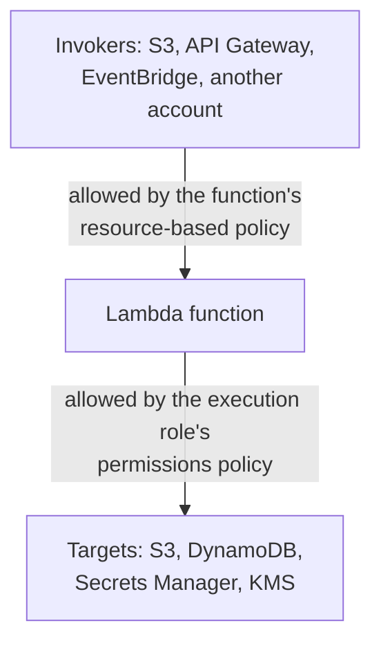
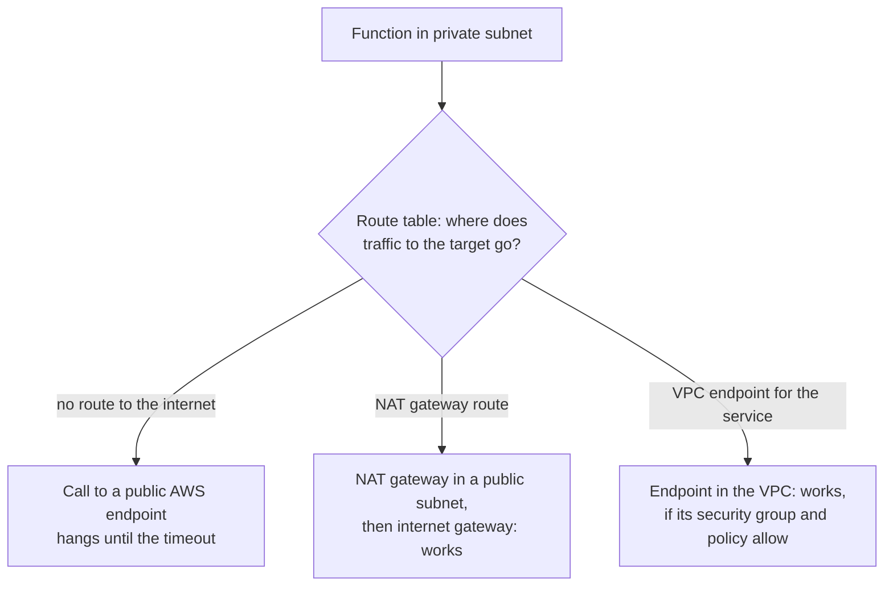

# Lambda networking and permissions

> **Status: AI draft, 2026-11-16.** Not yet verified by me. Written from the AWS Lambda and Secrets Manager documentation; no AWS calls were made.

## In one line

The execution role says what a Lambda function may call; its resource-based policy says who may invoke it. In a VPC the function reaches private resources through interfaces in your subnets but gets no public IP, so it needs NAT or VPC endpoints to reach anything else.

## The plain idea

Two separate questions decide whether a Lambda function works:

- **Permissions**: may the function call S3, DynamoDB or Secrets Manager (its **execution role**), and may S3, API Gateway or another account trigger it (its **resource-based policy**)?
- **Network path**: can packets get from the function to the thing it calls? Outside a VPC, Lambda has internet access managed by AWS. Inside your VPC, it lives by your VPC's rules: subnets, route tables, security groups, NAT and endpoints ([VPC basics](../aws-core/vpc-basics.md)).

Most "my Lambda times out" incidents are the second question; most "AccessDenied" ones are the first.

## How it works

### Two policies, two directions

| | Execution role | Resource-based policy |
|---|---|---|
| Answers | What can the function do? | Who can invoke the function? |
| Is | An IAM role trusted by `lambda.amazonaws.com` ([IAM roles and STS](../aws-core/iam-roles-and-sts.md)) | A policy attached to the function (`lambda:InvokeFunction` for a principal) |
| Typical content | `logs:*` for its log group, `s3:GetObject` on one bucket, `secretsmanager:GetSecretValue` on one secret | `Principal: s3.amazonaws.com` with `aws:SourceArn` and `aws:SourceAccount` conditions |
| Error when missing | `AccessDenied` when the function calls the service | The trigger cannot invoke; API Gateway returns 500 or the event is dropped |

Always add `SourceArn` and `SourceAccount` conditions for service principals, so only *your* bucket or API can invoke the function ([IAM policies and how they are evaluated](../aws-core/iam-policies.md)).

### Lambda in a VPC

- You pick subnets and security groups; Lambda creates **Hyperplane ENIs** in those subnets (shared across functions using the same subnet and security group combination) and routes the function's traffic through them. The execution role needs permissions to manage network interfaces (AWS provides a managed policy for VPC access).
- The function gets **no public IP**: attaching it to a public subnet does not give it internet access.
- To reach the internet: private subnets whose route table sends `0.0.0.0/0` to a NAT gateway in a public subnet ([Routing and NAT](../networking/routing-and-nat.md)).
- To reach AWS APIs without internet: VPC endpoints (gateway endpoints for S3 and DynamoDB, interface endpoints for Secrets Manager, STS, SQS and others) ([NAT, endpoints and PrivateLink](../aws-core/nat-endpoints-privatelink.md)).
- **Security groups**: the function's security group needs outbound rules to its targets; the targets' security groups must allow inbound from the function's security group ([Security groups and NACLs](../aws-core/security-groups-and-nacls.md)).

### Why a VPC Lambda times out

Packets to a public AWS endpoint from a subnet with no NAT route are silently dropped, so the SDK waits until the function's timeout: `Task timed out`, not an error message. Fix the route (NAT) or add an endpoint; check DNS resolution of the endpoint name too ([DNS](../networking/dns.md)).

Do not attach a function to a VPC unless it needs private resources (a database, an internal service): without a VPC, AWS handles its internet path.

### Secrets at cold start

- Fetch secrets during init (outside the handler) and cache them for the life of the environment, refreshing after a time so rotation is picked up ([Secrets management](../security/secrets-management.md)).
- The AWS Parameters and Secrets Lambda Extension retrieves and caches Secrets Manager secrets and Parameter Store parameters for the function, with a local HTTP endpoint.
- In a VPC, the fetch needs a path to Secrets Manager (NAT or an interface endpoint).

### Environment variables

Lambda always encrypts environment variables at rest with a KMS key (an AWS managed key by default, or your customer managed key). Anyone who can read the function's configuration can still see them in plain text in the console or API, so do not store secrets there; store references and fetch the value ([KMS and secrets stores](../aws-services/kms-and-secrets.md)).

## A concrete example

`sample-app`'s order function needs an RDS database in private subnets and reads one secret:

1. Attached to the three private subnets (one per zone) with security group `sg-orders-fn`; the database's security group allows 5432 from `sg-orders-fn`.
2. An interface endpoint for Secrets Manager in the VPC (private DNS on), so no NAT is needed for the secret.
3. Execution role: write its own logs, manage VPC interfaces (managed policy), `secretsmanager:GetSecretValue` on that one secret, `kms:Decrypt` on its key.
4. Resource-based policy: only the API Gateway API (by `SourceArn`) may invoke it.
5. The secret is fetched in init and cached for five minutes.

## Why not just...?

- **...put the function in a public subnet so it can reach the internet?** Lambda's interfaces get no public IP, so it still cannot. Use private subnets with a NAT gateway, or endpoints.
- **...give the execution role broad permissions to stop AccessDenied?** Any code path (or injected input) in the function then has them. Grant the exact actions and resources ([Least privilege and AccessDenied](../aws-core/least-privilege-and-accessdenied.md)).
- **...put the database password in an environment variable?** It is visible to anyone who can read the function configuration, and rotation needs a redeploy. Fetch from Secrets Manager.

## Commands to know

These were not run for this page.

| Command | What it does |
|---|---|
| `aws lambda get-function-configuration --function-name orders --query '{role:Role,vpc:VpcConfig}'` | Role and VPC settings. |
| `aws lambda get-policy --function-name orders` | The resource-based policy: who can invoke. |
| `aws lambda add-permission --function-name orders --statement-id apigw --action lambda:InvokeFunction --principal apigateway.amazonaws.com --source-arn <api-arn>` | Allow an API to invoke the function. |
| `aws iam simulate-principal-policy --policy-source-arn <role-arn> --action-names secretsmanager:GetSecretValue` | Check the execution role's permissions. |
| `aws ec2 describe-route-tables --filters Name=association.subnet-id,Values=<subnet-id>` | Does the subnet have a NAT route? |
| `aws ec2 describe-vpc-endpoints --filters Name=vpc-id,Values=<vpc-id>` | Which service endpoints exist. |

## How it breaks

| Symptom | Layer | Check | Likely cause |
|---|---|---|---|
| `Task timed out` on an AWS or internet call | Network path | Route table, endpoints | VPC function without NAT or endpoint |
| `AccessDenied` calling a service | Execution role | Role policy, resource policies, KMS key policy | Missing action or resource ([Least privilege and AccessDenied](../aws-core/least-privilege-and-accessdenied.md)) |
| Trigger configured but function never runs | Resource-based policy | `get-policy` | Service not allowed to invoke |
| Cannot connect to the database | Security groups | Inbound rule on the database's group | Function's security group not allowed |
| Function creation fails attaching to the VPC | Execution role | VPC access permissions | Role cannot manage network interfaces |
| Subnet out of addresses | Subnet size | Free IPs | Small subnets; Hyperplane ENIs need addresses ([IP addresses and subnetting](../networking/ip-and-subnetting.md)) |

## Interview questions

**1. What is the difference between a Lambda execution role and its resource-based policy?**

Answer

- Execution role: what the function may call (assumed by Lambda when it runs).
- Resource-based policy: who may invoke the function.
- AccessDenied from a call means the role; a trigger that never fires often means the resource policy.

**2. A Lambda in a VPC times out calling S3. Why, and how do you fix it?**

Answer

- It has no public IP and its subnet has no route to the internet, so packets to the public S3 endpoint are dropped and the call waits until timeout.
- Add an S3 gateway endpoint, or a NAT gateway route.
- Check the endpoint policy and DNS.

**3. Does putting a Lambda in a public subnet give it internet access?**

Answer

- No: VPC-attached Lambda interfaces never get public IPs.
- Use private subnets with a NAT gateway.
- Or avoid the VPC if the function does not need private resources.

**4. How should a Lambda function get a database password?**

Answer

- From Secrets Manager at init, cached with a refresh interval, or through the Parameters and Secrets extension.
- Execution role allowed to read that one secret and decrypt its key.
- Not in environment variables or code.

**5. How do you let only one S3 bucket invoke a function?**

Answer

- A resource-based policy statement for principal `s3.amazonaws.com`.
- Conditions on `aws:SourceArn` (the bucket) and `aws:SourceAccount`.
- Without them, another account's bucket could invoke it.

**6. When should a Lambda function be attached to a VPC?**

Answer

- Only when it must reach private resources: a database, an internal service, private endpoints.
- Then plan subnets with enough addresses, security groups, and NAT or endpoints for everything else it calls.
- Otherwise leave it outside the VPC.

## Try it

Without AWS:

1. Write the execution role policy for a function that reads one S3 prefix, writes to one DynamoDB table and logs to CloudWatch.
2. Draw the network path for a VPC function calling Secrets Manager, first via NAT and then via an interface endpoint.
3. Write the resource-based policy statement for an API Gateway API invoking the function.

## Zoom out

Lambda's networking is ordinary VPC networking, and its permissions are ordinary IAM; the same reasoning applies to ECS tasks and EKS pods with their own roles ([ECS and Fargate](ecs-and-fargate.md), [Cluster access, IRSA and Pod Identity](../eks/access-and-pod-identity.md), [VPC troubleshooting](../aws-core/vpc-troubleshooting.md)).

## Sources

- [AWS Lambda Developer Guide: connecting functions to a VPC](https://docs.aws.amazon.com/lambda/latest/dg/configuration-vpc.html)
- [AWS Lambda Developer Guide: internet access for VPC functions](https://docs.aws.amazon.com/lambda/latest/dg/configuration-vpc-internet.html)
- [AWS Lambda Developer Guide: execution role](https://docs.aws.amazon.com/lambda/latest/dg/lambda-intro-execution-role.html)
- [AWS Lambda Developer Guide: resource-based policies](https://docs.aws.amazon.com/lambda/latest/dg/access-control-resource-based.html)
- [AWS Lambda Developer Guide: securing environment variables](https://docs.aws.amazon.com/lambda/latest/dg/configuration-envvars-encryption.html)
- [AWS Secrets Manager: using secrets in Lambda](https://docs.aws.amazon.com/secretsmanager/latest/userguide/retrieving-secrets_lambda.html)
