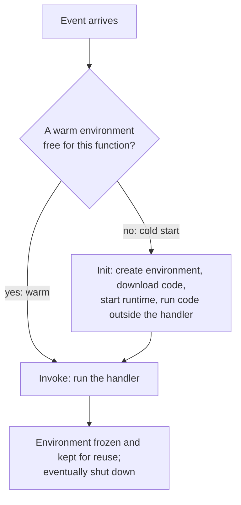

# Lambda

> **Status: AI draft, 2026-11-16.** Not yet verified by me. Written from the AWS Lambda Developer Guide; no AWS calls were made, so the commands have no sample output.

## In one line

Lambda runs your function when an event arrives, in an environment it creates on demand and reuses (the first run pays a cold start). Memory also sets CPU, runs last at most 15 minutes, concurrency is limited per account, and events arrive synchronously, asynchronously with retries, or in batches.

## The plain idea

With a server, you keep a process running and wait for work. With Lambda, you upload only the handler function, and AWS runs it when something happens: an HTTP request, a file landing in S3, a message on a queue, a schedule. You pay for the time it runs, not for idle time, and AWS adds copies when more events arrive at once.

The price is a set of rules you must design for: a time limit per run, a possible delay on the first run of a new copy, limits on how many copies run at once, and no local state you can count on between runs.

## How it works

### The execution environment

- **Init** happens once per environment: code outside the handler (SDK clients, database connections, loading config) runs here and is reused by later invocations in the same environment. Put expensive setup there.
- **Cold starts** are slower for large packages, heavy runtimes and initialisation work, and for functions in a VPC on first use of new network interfaces. Mitigations: smaller packages, lazy loading, **provisioned concurrency** (environments kept initialised), and SnapStart for supported runtimes.
- Each environment handles **one invocation at a time**; parallel events need parallel environments.
- `/tmp` and memory survive between invocations in the same environment, but you cannot rely on any particular environment being reused.

### Memory, CPU, timeout

| Setting | Range (from the quotas page) | Note |
|---|---|---|
| Memory | 128 MB to 10,240 MB | CPU scales with memory; at 1,769 MB a function has the equivalent of one vCPU |
| Timeout | Up to 900 seconds (15 minutes) | Longer work belongs in Step Functions, ECS or batch jobs ([Step Functions](step-functions.md), [ECS and Fargate](ecs-and-fargate.md)) |
| Invocation payload | 6 MB request and response for synchronous, 1 MB for asynchronous | Pass references (an S3 key), not large data |
| Layers | Up to 5 per function | |

More memory often makes a CPU-bound function both faster and cheaper, because duration drops more than the price per millisecond rises.

### Concurrency

- **Concurrency** = environments running at the same moment. Roughly requests per second times average duration.
- The **account concurrency quota** per region is shared by all functions (see the quotas page; it can be raised). When it is used up, invocations are **throttled** (429).
- **Reserved concurrency** sets aside part of the pool for one function and also caps it, protecting the rest of the account from a runaway function and protecting a critical function from the rest.
- **Provisioned concurrency** keeps a number of environments initialised, removing cold starts for that capacity, at a cost.

### Invocation types

| Type | Who waits | Errors | Typical sources |
|---|---|---|---|
| **Synchronous** | The caller waits for the response | Returned to the caller, who decides whether to retry | API Gateway, ALB, direct `Invoke` ([API Gateway](api-gateway.md)) |
| **Asynchronous** | Lambda queues the event and returns at once | Lambda retries twice by default (one minute, then two minutes later); throttled events are retried for up to 6 hours by default; failures go to a dead-letter queue or an on-failure destination | S3, SNS, EventBridge ([SQS, SNS and EventBridge](../aws-services/messaging.md)) |
| **Event source mapping** | Lambda polls the source and invokes with batches | Batch retried (whole or partially, if configured); poison messages to a DLQ | SQS, Kinesis, DynamoDB Streams, Kafka |

Make handlers **idempotent**: retries and at-least-once delivery mean the same event can arrive twice.

### Versions and aliases

- Publishing creates an immutable, numbered **version** of code and configuration; `$LATEST` is the editable one.
- An **alias** (`prod`, `staging`) points to a version and can split traffic between two versions with weights: a canary for functions ([Deployment strategies](../cicd/deployment-strategies.md)).
- Point triggers and API integrations at aliases, never at `$LATEST`.

### Packaging

| Format | Notes |
|---|---|
| Zip archive | Code plus dependencies; quick to deploy for small functions |
| Layers | Shared libraries or runtimes attached to several functions |
| Container image | Up to 10 GB, built with the AWS base images or a custom runtime, stored in ECR ([ECR](../aws-services/ecr.md)) |

### Logs and metrics

- Everything written to stdout and stderr goes to CloudWatch Logs, one log group per function; each invocation ends with a `REPORT` line with duration, billed duration, memory used and init duration on cold starts ([CloudWatch](../aws-services/cloudwatch.md)).
- Metrics: `Invocations`, `Errors`, `Throttles`, `Duration`, `ConcurrentExecutions`, plus `IteratorAge` for streams and `DeadLetterErrors` for async.

## A concrete example

`sample-app` resizes uploaded images:

1. S3 `ObjectCreated` events invoke the function asynchronously; an on-failure destination sends failed events to an SQS queue for inspection.
2. 1,769 MB memory (one vCPU), 60-second timeout; the S3 client is created outside the handler.
3. Reserved concurrency 50, so a flood of uploads cannot starve the API functions in the same account.
4. Deployed as container image versions; the `prod` alias shifts 10% to the new version, then 100% after the error metrics stay flat.
5. A CloudWatch alarm on `Errors` and `Throttles`, and a dashboard with `Duration` p99.

## Why not just...?

- **...run a long job in Lambda by raising the timeout?** The hard limit is 15 minutes. Split the work (Step Functions, SQS fan-out) or use a container task.
- **...open a new database connection in every invocation?** Hundreds of concurrent environments can exhaust the database's connections. Reuse connections from init, cap concurrency, or use RDS Proxy ([RDS and Aurora](../aws-services/rds-and-aurora.md)).
- **...rely on `$LATEST` in production?** Every deploy changes production instantly with no rollback target. Use versions and aliases.

## Commands to know

These were not run for this page.

| Command | What it does |
|---|---|
| `aws lambda invoke --function-name sample-resize --payload fileb://event.json out.json` | Synchronous test invocation. |
| `aws lambda get-function-configuration --function-name sample-resize` | Memory, timeout, role, VPC, environment. |
| `aws lambda publish-version --function-name sample-resize` | Create an immutable version. |
| `aws lambda update-alias --function-name sample-resize --name prod --function-version 7 --routing-config '{"AdditionalVersionWeights":{"8":0.1}}'` | Weighted alias: 10% to version 8. |
| `aws lambda put-function-concurrency --function-name sample-resize --reserved-concurrent-executions 50` | Reserved concurrency. |
| `aws logs tail /aws/lambda/sample-resize --follow` | Follow the function's logs. |

## How it breaks

| Symptom | Layer | Check | Likely cause |
|---|---|---|---|
| `Task timed out after N seconds` | Timeout | Duration metric, downstream calls | Slow dependency, VPC function without a network path ([Lambda networking and permissions](lambda-networking-and-permissions.md)) |
| 429 `TooManyRequestsException` | Concurrency | `Throttles`, account and reserved concurrency | Account quota reached, or reserved concurrency too low |
| Slow first requests after idle | Cold start | `Init Duration` in REPORT lines | Large package or heavy init; consider provisioned concurrency |
| Events processed twice | Delivery | Idempotency | Retries and at-least-once delivery |
| Queue backlog grows | Event source mapping | Batch size, errors, `IteratorAge` | Function failing on a poison message, or concurrency too low |
| `Runtime exited ... out of memory` | Memory | `Max Memory Used` | Memory too low for the workload |

## Interview questions

**1. Explain a Lambda cold start and how to reduce it.**

Answer

- The first invocation on a new execution environment runs init: create the environment, load code, start the runtime, run init code.
- Reduce with smaller packages, less init work, provisioned concurrency, SnapStart where supported.
- Warm invocations reuse the environment and skip init.

**2. What are reserved and provisioned concurrency?**

Answer

- Reserved: guarantees and caps concurrency for one function out of the account pool.
- Provisioned: keeps environments initialised so those invocations have no cold start; costs extra.
- Both are about concurrency, not requests per second directly.

**3. Compare synchronous, asynchronous and event source mapping invocations.**

Answer

- Synchronous: the caller waits and handles errors (API Gateway).
- Asynchronous: Lambda queues and retries (twice by default), then sends failures to a DLQ or destination (S3, SNS, EventBridge).
- Event source mapping: Lambda polls SQS, Kinesis or streams and invokes with batches.

**4. How do you deploy a new Lambda version safely?**

Answer

- Publish a version; point an alias at it with a weight (for example 10%).
- Watch errors and duration; shift to 100% or back.
- Triggers always point at the alias, never `$LATEST`.

**5. Why might more memory make a function cheaper?**

Answer

- CPU scales with memory, so CPU-bound code finishes faster.
- Cost is memory times duration; if duration falls proportionally more, the total drops.
- Measure with real workloads at several settings.

**6. A Lambda behind SQS keeps reprocessing the same messages and the queue grows. What do you check?**

Answer

- Errors in the function: one bad message fails the whole batch, which is retried.
- Visibility timeout vs function timeout; partial batch responses; a DLQ with a max receive count.
- Concurrency and batch size against the arrival rate.

## Try it

Without an AWS account:

1. Write a handler where the SDK client is created outside the handler, and explain which line runs once per environment.
2. A function averages 200 ms and receives 500 requests per second. Estimate its concurrency. (Answer: about 500 × 0.2 = 100.)
3. Design the error handling for an S3-triggered function: retries, destination, alarm.

## Zoom out

Lambda is one end of the compute spectrum: no servers to manage, strict limits. ECS on Fargate and EKS sit further along with more control ([ECS and Fargate](ecs-and-fargate.md), [EKS architecture and node options](../eks/architecture.md)). Networking and permissions, which cause most real Lambda problems, have their own page ([Lambda networking and permissions](lambda-networking-and-permissions.md)).

## Sources

- [AWS Lambda Developer Guide: execution environment lifecycle](https://docs.aws.amazon.com/lambda/latest/dg/lambda-runtime-environment.html)
- [AWS Lambda Developer Guide: quotas](https://docs.aws.amazon.com/lambda/latest/dg/gettingstarted-limits.html)
- [AWS Lambda Developer Guide: concurrency](https://docs.aws.amazon.com/lambda/latest/dg/lambda-concurrency.html)
- [AWS Lambda Developer Guide: provisioned concurrency](https://docs.aws.amazon.com/lambda/latest/dg/provisioned-concurrency.html)
- [AWS Lambda Developer Guide: asynchronous invocation error handling](https://docs.aws.amazon.com/lambda/latest/dg/invocation-async-error-handling.html)
- [AWS Lambda Developer Guide: event source mappings](https://docs.aws.amazon.com/lambda/latest/dg/invocation-eventsourcemapping.html)
- [AWS Lambda Developer Guide: aliases](https://docs.aws.amazon.com/lambda/latest/dg/configuration-aliases.html)
- [AWS Lambda Developer Guide: container images](https://docs.aws.amazon.com/lambda/latest/dg/images-create.html)
