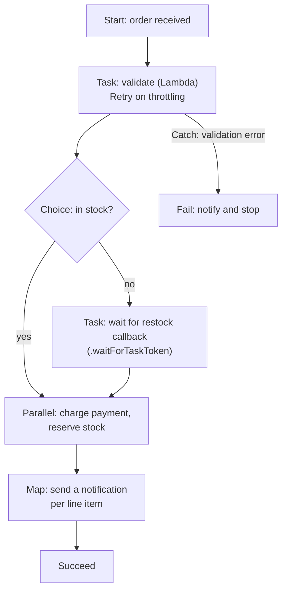

# Step Functions

> **Status: AI draft, 2026-11-16.** Not yet verified by me. Written from the AWS Step Functions Developer Guide; no AWS calls were made.

## In one line

Step Functions runs a state machine you define in JSON (Amazon States Language): each state does work, makes a choice, runs branches in parallel, loops over items or waits, with retries and error catching built in. Standard workflows run up to a year with a full audit history; Express workflows run up to five minutes at high volume.

## How it works

| State | Does |
|---|---|
| **Task** | Calls a Lambda function, an AWS service API, or an HTTP endpoint |
| **Choice** | Branches on values in the state's input |
| **Parallel** | Runs branches at the same time and waits for all |
| **Map** | Runs the same steps for each item in a list (inline, or distributed for very large data sets) |
| **Wait** | Pauses for a duration or until a time |
| **Pass**, **Succeed**, **Fail** | Shape data, end successfully, end with an error |

| | Standard | Express |
|---|---|---|
| Maximum duration | One year | Five minutes |
| Execution model | Exactly-once workflow execution | At-least-once |
| History | Full execution history in the console and API | Logs to CloudWatch |
| Fits | Long, auditable business processes, human approvals | High-volume event processing, mobile backends |

The workflow type cannot be changed after the state machine is created.

**Error handling**: each Task can have `Retry` rules (which errors, interval, backoff rate, maximum attempts, jitter) and `Catch` rules (which errors go to which fallback state). This replaces retry and error code scattered across functions ([High availability and failure domains](../operations/high-availability.md)).

**Service integrations**, three patterns:

- **Request response**: call the service and move on as soon as it answers.
- **Run a job (`.sync`)**: start something (an ECS task, a Glue job, a nested workflow) and wait until it finishes ([ECS and Fargate](ecs-and-fargate.md)).
- **Wait for callback (`.waitForTaskToken`)**: pass a token to someone (a queue consumer, a human approval email); the workflow pauses until they return it.

Standard and Express support the same integrations, but not all the same patterns (Express does not support `.sync` or callbacks).

**Instead of chaining Lambdas**: when one function calls the next, the error handling, retries, timeouts and state live inside code, and a failure halfway leaves no record of where it stopped. A state machine makes the flow visible, retries declarative, and every execution traceable; functions stay small and single-purpose ([Lambda](lambda.md)).

## Interview questions

**1. When would you use Step Functions instead of chaining Lambda functions?**

Answer

- Multi-step processes needing retries, branching, parallelism, waits or human approval.
- The flow and its error handling become declarative and visible, with a history per execution.
- Functions stay small; no function waits on another (paying for idle time).

**2. Standard or Express workflows?**

Answer

- Standard: up to one year, exactly-once workflow execution, full history; for long, auditable processes.
- Express: up to five minutes, at-least-once, high volume; for event processing.
- The type cannot be changed later.

**3. How do Retry and Catch work?**

Answer

- Retry: for matching errors, wait and try again with backoff up to a maximum number of attempts.
- Catch: after retries are exhausted (or for non-retryable errors), route to a fallback state with the error details.
- Both are per state, in the state machine definition.

**4. How do you wait for a human approval in a workflow?**

Answer

- A Task with the `.waitForTaskToken` pattern sends a token (for example in an email or a queue message).
- The workflow pauses until something calls `SendTaskSuccess` or `SendTaskFailure` with the token.
- Standard workflows can wait up to a year; add a timeout.

**5. What does the Map state do?**

Answer

- Runs the same sub-workflow for each item in an array, with configurable concurrency.
- Distributed mode handles very large data sets (for example many objects in S3) as child executions.
- Errors per item can be retried or tolerated up to a threshold.

## Sources

- [AWS Step Functions Developer Guide: choosing a workflow type](https://docs.aws.amazon.com/step-functions/latest/dg/choosing-workflow-type.html)
- [AWS Step Functions Developer Guide: workflow states](https://docs.aws.amazon.com/step-functions/latest/dg/workflow-states.html)
- [AWS Step Functions Developer Guide: error handling](https://docs.aws.amazon.com/step-functions/latest/dg/concepts-error-handling.html)
- [AWS Step Functions Developer Guide: service integration patterns](https://docs.aws.amazon.com/step-functions/latest/dg/connect-to-resource.html)
