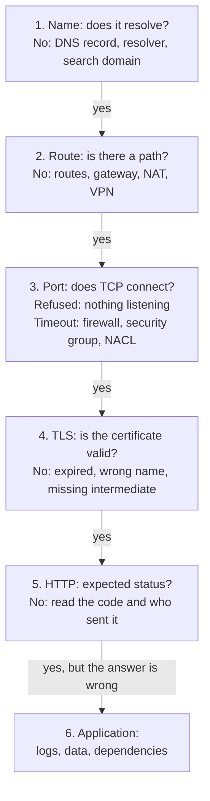

# The debugging walk

> **Status: AI draft, 2026-11-16.** Not yet verified by me. Commands and output were run in throwaway containers; addresses are rewritten to example ranges.

## In one line

When something "does not work", test the layers in order: name, route, port, TLS, HTTP, application. Each step either passes, and you move up, or fails, and tells you exactly which layer, which tool and which owner to look at next.

## Why a fixed order

"It does not work" hides at least six different problems, each with a different owner: DNS, the network path, the service, its certificate, the proxy in front of it, and the application itself. Guessing jumps straight to a favourite suspect. A fixed order from the bottom up is faster on average, because each step is cheap, and because every later step depends on the ones before it: there is no point reading HTTP headers if the name never resolved.



## The six steps

| Step | Question | Command | Pass | Fail, and what it proves |
|---|---|---|---|---|
| 1. Name | Does it resolve, and to what? | `dig +short api.example.com`, or `getent ahostsv4 api.example.com` | One or more addresses | `NXDOMAIN`: the name does not exist. No answer: the resolver cannot be reached. Wrong address: stale record, split-horizon or `/etc/hosts` ([DNS](../networking/dns.md)) |
| 2. Route | Is there a path to the address? | `ip route get 203.0.113.10`; `traceroute -n -T -p 443 203.0.113.10` | A route and gateway; hops reaching the target | `Network is unreachable`: no route. Hops stop: something on the path ([Routing and NAT](../networking/routing-and-nat.md)) |
| 3. Port | Does a TCP connection open? | `nc -vz -w3 203.0.113.10 443` | `succeeded` | `refused`: host reached, nothing listening. Timeout: packets dropped ([TCP and UDP](../networking/tcp-and-udp.md)) |
| 4. TLS | Is the certificate valid for this name? | `curl -sv -o /dev/null https://api.example.com/` and read the certificate lines | `SSL certificate verify ok` | Expired, name mismatch, untrusted chain ([TLS and certificates](../networking/tls.md)) |
| 5. HTTP | What status, and who sent it? | `curl -s -o /dev/null -w "%{http_code}\n" https://api.example.com/health` | The expected code | `404` route or path; `401`/`403` auth; `502`/`503`/`504` from a proxy about its backend ([HTTP](../networking/http.md)) |
| 6. Application | Is the answer right? | Application logs, metrics, traces; the dependency it calls | Correct data | Bugs, bad data, a slow or failing dependency, which starts its own walk |

`curl -v` performs steps 1, 3, 4 and 5 in one command and stops at the first failure ([curl -v, line by line](../networking/curl-v-annotated.md)). Use the separate tools when you need to know more about the failing step.

## What each failure looks like

Real outputs from these notes' exercises:

```console
$ dig nosuchname.invalid A
;; ->>HEADER<<- opcode: QUERY, status: NXDOMAIN, id: 41950
$ ip netns exec client ping -c1 -W1 10.0.2.2
ping: connect: Network is unreachable
$ nc -vz -w2 10.0.2.2 9090
nc: connect to 10.0.2.2 port 9090 (tcp) failed: Connection refused
$ nc -vz -w3 10.0.2.2 9091
nc: connect to 10.0.2.2 port 9091 (tcp) timed out: Operation now in progress
$ curl -sS --cacert ca.crt --resolve api.example.com:8443:127.0.0.1 https://api.example.com:8443/
curl: (60) SSL: no alternative certificate subject name matches target host name 'api.example.com'
$ curl -s -o /dev/null -w "%{http_code}\n" http://127.0.0.1:8080/
502
```

## Habits that make the walk work

- **Test from where the problem is.** A check from your laptop proves your laptop's path. Run the walk from the failing pod, node or function's network, using a debug container if needed ([Network tools on Linux](../networking/network-tools.md)).
- **Change one thing at a time,** and re-run the same check after each change. Two changes at once teach you nothing about which one worked.
- **Suspect the measuring tool.** `ping` failing may mean ICMP is blocked, not that the host is down. `dig` ignores `/etc/hosts`. A health check can pass while the real path fails.
- **Read errors literally.** "Refused" and "timed out" are different facts. A `502` comes from a proxy, not from the application.
- **Write three lines before asking for help:** what you expected, what you saw, what you think it means. Writing them often answers the question, and if not, it makes the question answerable.

## A concrete example

A pod cannot call `https://payments.example.com`.

1. **Name**: `getent ahostsv4 payments.example.com` from the pod returns `203.0.113.40`. Pass.
2. **Route**: `ip route get 203.0.113.40` shows the default route via the node. Pass.
3. **Port**: `nc -vz -w3 203.0.113.40 443` times out. Fail, with a timeout, so something drops packets.
4. The same `nc` from the node succeeds. So the node's path works and only the pod's is blocked: a NetworkPolicy with an egress allow-list, or a security group for pods ([Pod networking and NetworkPolicy](../kubernetes/pod-networking-and-network-policy.md)).
5. The namespace has a default-deny egress policy without a rule for this destination. Add one, re-run step 3, then continue up the walk: TLS and HTTP still have to pass.

## Interview questions

**1. A user says "the website is down". Walk me through how you diagnose it.**

<details markdown="1">
<summary>Answer</summary>

- Confirm and scope: which URL, from where, since when, everyone or some.
- Walk the layers: DNS resolution, route, TCP connect to 443, TLS validity, HTTP status, then application logs.
- Stop at the first failing step; the kind of failure (NXDOMAIN, refused, timeout, certificate error, 5xx) says which component and team.

</details>

**2. What is the difference between "connection refused" and "connection timed out", and what does each tell you to check?**

<details markdown="1">
<summary>Answer</summary>

- Refused: the host answered with a reset; nothing listens on the port, or a reject rule. Check the service and its listening address.
- Timeout: no answer; packets are dropped. Check security groups, NACLs, firewalls, routes and the return path.

</details>

**3. Why should you run checks from the failing component rather than from your laptop?**

<details markdown="1">
<summary>Answer</summary>

- Network paths, DNS resolvers, policies and credentials differ by location.
- A check from your laptop proves only your laptop's path.
- Use a debug container in the pod's namespace, or the node, to test the real path.

</details>

**4. `ping` to a server fails but the website works. What do you conclude?**

<details markdown="1">
<summary>Answer</summary>

- ICMP is probably blocked by a firewall or security group; it is not evidence that the host is down.
- Test the actual protocol and port: `nc -vz host 443` or `curl`.
- Choose tools that test what the application uses.

</details>

**5. A health check passes but users get errors. How can that be?**

<details markdown="1">
<summary>Answer</summary>

- The health check tests a different path: maybe only that the process is up, not its dependencies or the real route.
- It may run from inside the network while users come through DNS, a CDN, TLS and a load balancer.
- Walk the users' path, from their side, layer by layer.

</details>

**6. You get a `504` from the load balancer. Where in the walk are you, and what next?**

<details markdown="1">
<summary>Answer</summary>

- DNS, TCP and TLS to the load balancer all worked, and it returned an HTTP status: step 5.
- `504` means its backend did not answer in time.
- Next: the backend's latency and logs, and its own dependencies, which may need their own walk.

</details>

## Try it

**Step 1.** Start a container with the tools.

```bash
docker run --rm -it ubuntu:24.04 bash
apt-get update -qq && apt-get install -y -qq dnsutils iproute2 netcat-openbsd curl ca-certificates
```

**Step 2.** Walk `example.com` through every step, writing pass or fail for each before moving on.

```bash
dig +short example.com
ip route get 1.1.1.1
nc -vz -w3 example.com 443
curl -sv -o /dev/null https://example.com/ 2>&1 | grep -E "verify ok|expire date"
curl -s -o /dev/null -w "%{http_code}\n" https://example.com/
```

**Step 3.** Break one step at a time and name the layer from the output alone: an invented name, a closed port, an HTTP path that does not exist.

```bash
dig +short no-such-name.example.invalid
nc -vz -w3 1.1.1.1 81
curl -s -o /dev/null -w "%{http_code}\n" https://example.com/does-not-exist
```

**Step 4.** Type `exit`. The container is deleted.

## Zoom out

The walk is the same at every scale, from one server to a Kubernetes cluster behind a cloud load balancer; only the number of hops changes ([One request, end to end](request-path.md), [Troubleshooting playbook](../kubernetes/troubleshooting.md)). Interviewers ask "the site is down, what do you do?" precisely to see whether you have such a method. The principle to carry: find the last thing that worked, and the fault is in the next layer up.

## Sources

- [dig manual page](https://manpages.ubuntu.com/manpages/noble/man1/dig.1.html)
- [ip-route(8) manual page](https://man7.org/linux/man-pages/man8/ip-route.8.html)
- [curl manual page](https://curl.se/docs/manpage.html)
- [RFC 9110: HTTP status codes](https://www.rfc-editor.org/rfc/rfc9110.html)
- [Google SRE book: effective troubleshooting](https://sre.google/sre-book/effective-troubleshooting/)
