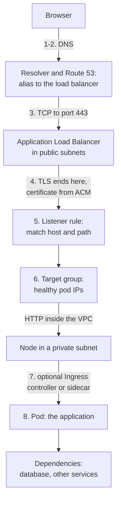

# One request, end to end

> **Status: AI draft, 2026-11-16.** Not yet verified by me. Commands are from the official documentation and were not run; output is illustrative.

## In one line

A request for `https://shop.example.com/api/orders` is resolved by DNS, carried by TCP to a load balancer, decrypted by TLS, routed by HTTP rules to a Kubernetes Service, and delivered to one pod's container. Every hop adds something, can break in its own way, and shows its failure with its own error.

## The whole path

This is the path for a typical web application on AWS with EKS. Other setups drop or add hops, but the questions at each hop stay the same.

The response (step 9) travels back along the same connections.

## Hop by hop

| Hop | What happens | Breaks as | First check | Home page |
|---|---|---|---|---|
| 1-2. DNS | The browser's resolver finds the address. On AWS, a Route 53 alias record points the name at the load balancer. | `Could not resolve host`, or an old address after a change | `dig shop.example.com` | [DNS](../networking/dns.md), [Route 53 and ACM](../aws-core/route53-and-acm.md) |
| 3. TCP | The browser opens a connection to port 443 on one of the load balancer's addresses. | Timeout: security group or NACL. Refused: no listener on 443 | `nc -vz shop.example.com 443` | [TCP and UDP](../networking/tcp-and-udp.md), [Security groups and NACLs](../aws-core/security-groups-and-nacls.md) |
| 4. TLS | The load balancer presents the certificate for `shop.example.com` (chosen by SNI) and decrypts the traffic. | Expired, wrong name, missing chain | `curl -v https://shop.example.com/` | [TLS and certificates](../networking/tls.md) |
| 5. Routing | Listener rules match host and path and pick a target group. With the AWS Load Balancer Controller, these rules come from a Kubernetes Ingress. | `404` from the load balancer: no rule matches | The Ingress and the listener rules | [ALB and NLB](../aws-core/load-balancers.md), [AWS Load Balancer Controller](../eks/load-balancer-controller.md) |
| 6. Targets | With the VPC CNI, pods have VPC addresses, so the load balancer can send straight to pod IPs registered in the target group. Only healthy targets get traffic. | `503`: no healthy targets. `502`: target refused or reset. `504`: target too slow | Target health; pod readiness | [Networking with the VPC CNI](../eks/vpc-cni.md), [Load balancers and proxies](../networking/load-balancers-and-proxies.md) |
| 7. In-cluster hops | Some designs send traffic to an Ingress controller or mesh gateway first, then through a Service to a pod, possibly through a sidecar proxy. | `502`/`503` from the controller or the sidecar; mTLS mismatches | Controller or proxy logs; `kubectl get endpointslices` | [Services and DNS](../kubernetes/services-and-dns.md), [Why a mesh](../mesh/why-a-mesh.md) |
| 8. The pod | The container's process handles the request, often calling a database or another service, each with its own walk. | `500` from the app; timeouts to dependencies | Application logs; `kubectl logs` | [Pods](../kubernetes/pods.md), [Probes and graceful shutdown](../kubernetes/probes-and-graceful-shutdown.md) |
| 9. The way back | The response returns along the same connections. | Idle timeouts cutting long responses; proxies buffering | Timeouts along the chain | [Load balancers and proxies](../networking/load-balancers-and-proxies.md) |

## Where the network boundaries are

- **Public to VPC.** The load balancer sits in public subnets, which route to an internet gateway. Nodes and pods sit in private subnets with no inbound route from the internet ([VPC basics](../aws-core/vpc-basics.md)).
- **Load balancer to pod.** The pod's security group, or the node's, must allow traffic from the load balancer's security group on the container port.
- **Pod to the outside world.** Calls out from private subnets leave through a NAT gateway, or through VPC endpoints for AWS services ([NAT, endpoints and PrivateLink](../aws-core/nat-endpoints-privatelink.md)).
- **Where TLS ends.** In this design, at the load balancer. Traffic inside the VPC is plain HTTP unless the load balancer re-encrypts or a mesh adds mTLS.

## Reading an error by who sent it

| What the user sees | Who produced it | Meaning |
|---|---|---|
| Browser error page, no status code | The browser | DNS, TCP or TLS failed before any HTTP |
| `404` with the load balancer's plain page | The load balancer | No listener rule matched |
| `502`, `503` or `504` with the load balancer's page | The load balancer | Its targets refused, were all unhealthy, or were too slow |
| `502` or `503` with an Ingress controller or Envoy body | The controller or the sidecar | The same, one hop further in |
| `500` or a JSON error body | The application | It received the request and failed handling it |

Response bodies and the `server` header often say which component answered, which tells you which hop to investigate.

## A concrete example

After a deploy, users get `503` from `shop.example.com`.

1. DNS, TCP and TLS work: the browser receives an HTTP status, so hops 1 to 4 are fine.
2. The body is the load balancer's own page, so the load balancer generated the `503`: it has no healthy targets (hop 6).
3. The target group shows every new pod as unhealthy. Their health check path returns `500`.
4. `kubectl logs` on a new pod shows the application cannot read its configuration: a missing Secret key (hop 8).
5. Roll back the deploy, fix the configuration, deploy again. The path told you where to look in three steps.

## Interview questions

**1. Describe everything that happens when a user opens `https://shop.example.com` served from EKS.**

Answer

- DNS resolves the name, through Route 53, to the load balancer.
- TCP connect to 443, TLS handshake with the certificate chosen by SNI.
- The load balancer matches host and path rules and forwards to a healthy target: a pod IP from the VPC CNI.
- The pod's container handles it, possibly calling dependencies; the response returns the same way.

**2. Where does TLS usually terminate in this design, and what are the implications?**

Answer

- At the load balancer, using a certificate from ACM.
- Traffic from the load balancer to pods is plain HTTP inside the VPC unless re-encrypted.
- Applications see HTTP and must use `X-Forwarded-Proto` to know the original scheme.

**3. The site returns `503` from the load balancer after a deploy. Walk through your diagnosis.**

Answer

- A `503` from the load balancer means no healthy targets.
- Check target health and the health check path; check the pods' readiness and logs.
- Common causes: the new version fails health checks, the port changed, or security groups block the load balancer from the pods.

**4. How does traffic reach a pod with no public address?**

Answer

- The load balancer is in public subnets and has public addresses.
- It forwards over the VPC's private network to the pod IP or node.
- The pod's subnet has no inbound route from the internet; outbound calls go through NAT or VPC endpoints.

**5. Some users see an old version of the site after a DNS change. Which hop, and why?**

Answer

- Hop 1: their resolvers cached the old record until its TTL expires.
- Confirm with `dig` against different resolvers and against the authoritative server.
- Lower the TTL before planned changes.

**6. A request fails only for large file uploads. Which hops would you suspect?**

Answer

- Body size limits at a proxy or Ingress controller (`413`), or in the application.
- Timeouts somewhere on the chain for slow uploads (`504` or a reset).
- MTU problems on a tunnel or VPN that drop large packets.

## Try it

*Untested: written from documentation.* A paper exercise, about 10 minutes.

**Step 1.** Pick a service you know. Draw its path like the diagram above: every proxy, load balancer, gateway and sidecar between a user and the code.

**Step 2.** For each hop, write the command you would use to test it, and the error you would see if it failed.

**Step 3.** Mark where TLS ends, which hops can return `502` or `503`, and which security groups or policies must allow the traffic.

## Zoom out

This page is the map that the rest of these notes fill in: each hop has its own section, and the [debugging walk](debugging-walk.md) is how you move along it when something breaks. In interviews, being able to draw this path quickly, and to say where each error comes from, shows that you understand the system rather than individual tools. The principle to carry: every request crosses many owners, so know which one is answering.

## Sources

- [Amazon Route 53: routing traffic to an Elastic Load Balancing load balancer](https://docs.aws.amazon.com/Route53/latest/DeveloperGuide/routing-to-elb-load-balancer.html)
- [Elastic Load Balancing: Application Load Balancer listeners](https://docs.aws.amazon.com/elasticloadbalancing/latest/application/load-balancer-listeners.html)
- [AWS Load Balancer Controller documentation](https://kubernetes-sigs.github.io/aws-load-balancer-controller/latest/)
- [Amazon EKS: pod networking with the Amazon VPC CNI](https://docs.aws.amazon.com/eks/latest/userguide/managing-vpc-cni.html)
- [Kubernetes documentation: Service](https://kubernetes.io/docs/concepts/services-networking/service/)
