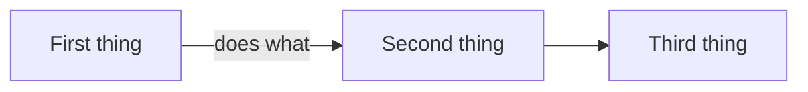

# Page title

> **Status: AI draft, YYYY-MM-DD.** Not yet verified by me. Commands and output were run in a throwaway container; addresses are rewritten to example ranges.

## In one line

The answer you would say aloud in 20 seconds. 40 words at most.

## The plain idea

Everyday words first. Then attach the **term**.

## How it works

Build the mechanism from primitives, step by step.



## A concrete example

One worked scenario from start to finish, with example values.

## Why not just...?

- **...the tempting shortcut?** Why it fails.
- **...the other tempting shortcut?** Why it fails.

## Commands to know

```console
$ command --flag value
real output
```

`--flag` does this.

## How it breaks

| Symptom | Layer | Check | Likely cause |
|---|---|---|---|
| What you see | Where it is | The command to run | What usually caused it |

## Interview questions

**1. A recall question?**

<details markdown="1">
<summary>Answer</summary>

- A point a strong answer contains.
- Another point.
- Another point.

</details>

**2. A second question?**

<details markdown="1">
<summary>Answer</summary>

- A point.
- Another point.
- Another point.

</details>

## Try it

**Step 1.** Start a throwaway container.

```bash
docker run --rm -it ubuntu:24.04 bash
```

**Step 2.** The step that matters. Predict the result before you run it.

```bash
command --flag value
```

**Step 3.** Type `exit` to leave. The container is deleted.

## Zoom out

Where this sits in the bigger path, what breaks without it, and the principle to carry to the next problem.

## Sources

- [Official documentation page](https://example.com/docs)
- [Second source](https://example.com/reference)
